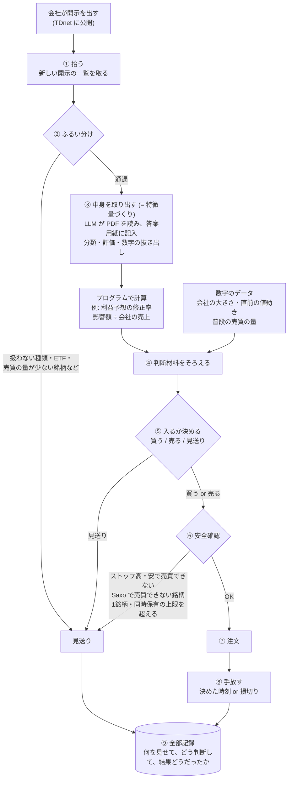
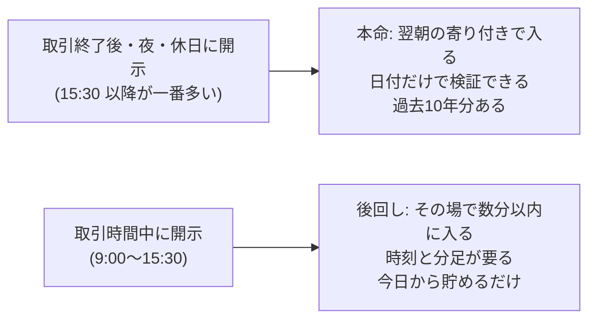
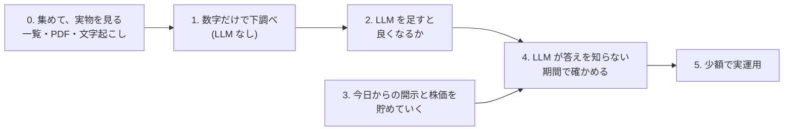

# 計画: 開示を読んでエントリーするまでの流れ

作成: 2026-10-31
この文書は「何を作ろうとしていて、どういう順番で確かめるか」を1か所で見渡すためのもの。
経緯や調査済みの事実は [HANDOFF.md](../HANDOFF.md) にある。ここで「案」と書いたものは、まだ決まっていない。

---

## 1. ひとことで

会社が適時開示を出す → 中身を読んで「良い話か悪い話か、どのくらい意外か」を判断する → 株価が動く前、または動いている途中に乗る。
これを、どの会社の開示にも**同じ手順**で当てはめて、1日に何十回も回す。

ポイントは**銘柄ごとに作戦を作るのではなく、開示1件ごとに同じ手順で判断する**こと。
会社ごとの違い (大きい会社か小さい会社か等) は、判断の「材料の一つ」として入るだけ。
同じ手順がどの銘柄にも同じように効くとは限らないので、結果は会社の大きさ別などに分けて見る。

**一番大事なのは、FX より独立な勝負をたくさんできること** (§7)。売買の回数が多くても、一緒に動く勝負ばかりなら意味がない。

### 株ならではのルールと偏り (この文書で扱うもの)

| こと | 何が問題か | どこで扱うか |
|---|---|---|
| 消えた会社 | 今ある銘柄だけで検証すると結果がずれる | §3 |
| 同じ会社の同時発表 | 1つの出来事を何回にも数えてしまう | §3 |
| アナリストの予想の有無 | 大きい会社は期待との差で動く。小さい会社は会社自身の予想が基準 | §3 |
| 開示の時刻 | 多くは取引終了後に出て、翌朝の寄り付きで値段がもう飛んでいる | §4 |
| ストップ高・安 | 一番おいしい候補ほど買えない | §4 |
| 決算の時期への集中 | ピークの日は候補が多すぎて全部は入れない | §7 |
| 同じ日・同じ業種の連動 | 独立な勝負の回数が見かけより少なくなる | §7 |

---

## 2. エントリーまでの流れ (図)



### 各ステップで何をするか

| # | ステップ | やること | 担当 | まだ決まっていないこと |
|---|---|---|---|---|
| ① | 拾う | 開示の一覧を取ってくる。過去分は東証上場会社情報サービス、実運用では TDnet (§5) | 仕組み | — |
| ② | ふるい分け | 中身を読まずに、一覧の情報だけで大半を落とす (§3) | 仕組み | 残す種類、売買の量の基準 |
| ③ | 中身を取り出す | LLM が PDF を読み、決まった答案用紙に記入する (= 構造化、特徴量づくり)。数字での計算はプログラムでやる | 読む: LLM / 計算: 仕組み | 答案用紙の項目、文字起こしの道具、モデル (§6) |
| ④ | 材料をそろえる | ③の結果に、株価などの数字を足す | 仕組み | どの数字を使うか |
| ⑤ | 入るか決める | ④をもとに 買う / 売る / 見送り を決める | ルール or 機械学習。LLM は比べる候補 (§7) | 決め方そのもの。これを検証で固める |
| ⑥ | 安全確認 | 売買できない状態や、自分の注文で値段が動く銘柄を避ける。Saxo で売買できない銘柄はここで落とす | 仕組み | 上限の金額 |
| ⑦ | 注文 | Saxo に注文を出す | 仕組み | — |
| ⑧ | 手放す | 決めた時刻か、損切りの値段で手放す | 仕組み | いつ手放すか (案: その日の引け / 数日後) |
| ⑨ | 記録 | 見送りも含めて全部残す。後で答え合わせに使う | 仕組み | — |

### 答案用紙の例 (③で LLM に記入させるもの、案)

```
種類:              提携
良い話か悪い話か:   良い
意外さ:            5段階で 4
業績への影響:       金額の記載あり (年 X 億円)
もう織り込み済みか: 前から噂されていた形跡なし
```

形式が決まっていない文章でも、LLM に読ませて毎回同じ項目に記入させれば、表の形で比べられるようになる。

---

## 3. ② ふるい分けの詳細

開示は1日に数百件、決算の時期には千件を超える日もある。
ふるい分けは、それを「勝負する価値がありそうなもの」に減らす関所。目的は2つある。

- **LLM に読ませる量を減らす**: LLM は1件ごとに時間とお金がかかる
- **検証の対象をはっきりさせる**: 「どの開示を対象にしたか」が決まっていないと、後で比べられない

中身は読まない。一覧の情報 (日付・銘柄・題名・区分) だけで機械的に判断する。軽いものから順に当てる。

```
開示 (全部)
 │
 ├─ a. 訂正・取り消しか？ ──────→ 落とす (新しい材料ではない)
 ├─ b. 種類は扱うものか？ ──────→ 人事・日程のお知らせなどを落とす
 ├─ c. 普通の株か？ ────────────→ ETF・REIT・上場廃止が決まった銘柄を落とす
 ├─ d. 売買の量は十分か？ ──────→ 注文が薄すぎる銘柄を落とす
 ├─ e. 同じ会社の同時発表を1つに束ねる
 │
 ▼
③ 中身を取り出す へ   (落としたものも全部記録する)
```

**b. 種類は題名で振り分ける**
東証上場会社情報サービスには細かい種類のコードが無いので、題名の決まり文句で拾う。
例: 「業績予想の修正に関するお知らせ」「自己株式の取得に係る事項の決定に関するお知らせ」「剰余金の配当 (増配) に関するお知らせ」。
紛らわしいもの (「業績予想**及び配当予想**の修正」のように2種類が1つになったもの、「業績予想と実績値との**差異**」のように似て非なるもの) があるので、
**言葉のルールを作る → 振り分け結果を100件ほど目で確かめてルールを直す**。このとき見るのは振り分けの正しさだけで、株価は見ない。
実際、トヨタで「差異」を業績予想の修正として拾ったら、「子会社の個別業績の差異」が混ざった。

**決算短信も候補に入れる (方向)**
大きい会社では、決算はアナリストの予想の平均 (コンセンサス) と比べて評価され、「好決算なのに期待に届かず売られる」ことがよくある。アナリストの予想は有料データにしかないので、私たちには使えない。
一方、小さい会社にはアナリストがほとんど付いておらず、比べる相手は**会社自身の予想** (期初の予想と比べてどうか)、**進み具合** (半年で年間予想の何割か)、**来期の予想** (前の期より強気か弱気か) になる。どれも開示の中だけで測れる。
決算短信を入れると勝負の回数が倍以上になる (下の表)。最終的には全社の一覧で件数を確かめてから決める。

**d. 売買の量**
案: 自分の注文が、その銘柄の普段の1日の売買代金の 1% 以下に収まること (1回 50万円なら、普段1日 5,000万円以上)。金額も 1% も仮。
普段の売買代金は、開示の**前の日までの**数字で計算する (開示の後は売買が急に増えるので、それを使うと楽観的になる)。

**e. 同時発表を束ねる**
15:30 に「決算短信」「増配」「自社株買い」を同じ会社がまとめて出すことがよくある。3回の勝負と数えると独立な回数を水増しするので、同じ日の同じ時間帯に出たものは1つの出来事として束ね、③では束ごとに読む。

### どの銘柄を対象にするか: 消えた会社も入れる

過去の検証で「今も上場している銘柄だけ」に絞ると、「2026年まで生き残る」という当時は知り得なかった情報で銘柄を選ぶことになる。
消えた会社には、倒産・業績悪化で消えた会社 (外すと結果が良く見える) と、買収 (TOB・MBO) で消えた会社 (外すと良い材料の大当たりが抜ける) の両方があり、外したときに結果がどちらにずれるかも分からない。なので推測で済ませず、入れておく。

| 見方 | 対象 | 役割 |
|---|---|---|
| **本命** | その当時に上場していて、d の条件を満たしていた銘柄 | 合否はこれで判定する |
| 追加1 | 今も上場している銘柄だけ | 本命との差で、消えた会社の影響の大きさが分かる |
| 追加2 | 今の Saxo の一覧 (1,344 銘柄) にある銘柄だけ | 実運用に近い見え方。過去に Saxo が扱っていた銘柄の一覧は無いので、参考扱い |

当時はなかったが今はある銘柄は、過去の期間に開示も株価も無いので、何もしなくても自然に対象外になる。

### 舞台に上がる回数の見積もり

2026-10-31 に10社 (トヨタ + 市場ごとにくじで3社ずつ) の10年分を題名で数えた。くじは各市場の一覧の1ページ目 (コードの若い200社) から引いたので、建設・食品などの古い会社に寄っている。

| 会社 | 市場 | 期間 | 開示の総数 | 決算短信 | 業績予想の修正 | 予想と実績の差異 | 配当の修正 | 自社株買い | 4種を同日で束ねた数 | 1年あたり |
|---|---|---|---|---|---|---|---|---|---|---|
| トヨタ自動車 | プライム | 10年 | 304 | 43 | 3 | 0 | 2 | 19 | 22 | 2.2 |
| 日比谷総合設備 | プライム | 10年 | 273 | 55 | 16 | 0 | 4 | 10 | 24 | 2.4 |
| 関電工 | プライム | 10年 | 133 | 59 | 4 | 0 | 6 | 1 | 9 | 0.9 |
| 味の素 | プライム | 10年 | 236 | 54 | 19 | 2 | 1 | 10 | 24 | 2.4 |
| ガーデン | スタンダード | 1.9年 | 76 | 8 | 2 | 0 | 4 | 0 | 5 | 2.6 |
| 湖池屋 | スタンダード | 10年 | 100 | 40 | 5 | 1 | 4 | 0 | 9 | 0.9 |
| 住石HD | スタンダード | 10年 | 200 | 41 | 22 | 2 | 4 | 6 | 30 | 3.0 |
| GMO プロダクトプラットフォーム | グロース | 10年 | 179 | 40 | 9 | 1 | 4 | 1 | 14 | 1.4 |
| ニッソウ | グロース | 4.3年 | 79 | 17 | 7 | 4 | 0 | 0 | 11 | 2.6 |
| INGS | グロース | 2.1年 | 61 | 9 | 0 | 0 | 2 | 0 | 1 | 0.5 |

(「4種」は決算短信を除いた4種類。決算短信が年4回より多い会社は、英語版や補足資料が混ざっている。)

- 決算短信を除く4種で、1社あたり年約2回 (束ねた後)。会社による差が大きい (年0.5〜3回)。自社株買いは大きい会社に偏る
- 決算短信を入れると、1社あたり年4〜5回 (束ねた後)
- 上場は約3,700社 (2026-10-31 時点でプライム 1,546 / スタンダード 1,550 / グロース 590)。決算短信込みで**年1万5千回前後**、売買の量で半分落とすと**年8,000回前後**が舞台に上がる
- 10社からの概算なので、半分〜2倍はずれうる。全社の一覧を集めたら数え直す

---

## 4. 入るタイミング: 本命は「翌朝の寄り付き」

東証の取引時間は 9:00〜11:30 と 12:30〜15:30 (日本時間)。



- **本命 (翌朝の寄り付きで入る)**: 過去の開示の一覧には日付しかないが、この検証には日付で足りる。取引時間中に出た開示も「翌朝入る」として測ればよく、未来の情報を使うことにはならない (当日中の値動きを取り逃がす扱いになるだけ)
- **後回し (取引時間中にその場で入る)**: 開示の時刻が要るが、時刻が取れるのは TDnet の閲覧サイトの直近1か月分だけ。今日から貯めても、判断できる量になるには何か月〜1年かかる。分足が Saxo で過去にどこまで取れるかも未確認。なので今は貯めるだけにして、本命で手応えが出てから考える

### ストップ高・安の扱い (検証で)

大きな良い材料が出た小さい会社は、翌朝ストップ高 (その日の値上がりの上限) に張り付いて、**買えない**ことがよくある。一番おいしい候補ほど買えない。
検証では「ストップ高で寄り付かなかったもの (買い注文が多すぎて値段が付かなかったもの) は買えなかった」として扱う。そうしないと成績が実際より良く見える。
手放すときも同じで、ストップ安に張り付いた日は売れなかったとして扱う。

---

## 5. データをどこから取るか

| データ | 取り先 | 費用 | 中身・制約 |
|---|---|---|---|
| 過去の開示の一覧と PDF | [東証上場会社情報サービス](https://www2.jpx.co.jp/tseHpFront/JJK010010Action.do?Show=Show) | 無料 | 過去10年分。**日付のみで時刻なし**。区分 (決算情報 / 決定事実・発生事実 / その他 等)、PDF、決算短信は XBRL と文章の HTML 版も付く。上場廃止した会社は廃止後5年分だけ残る。毎日午前1時更新 |
| 直近の開示 (時刻つき) | [TDnet 適時開示情報閲覧サービス](https://www.release.tdnet.info/inbs/I_main_00.html) | 無料 | 直近31日分のみ。時:分 まで分かる。実運用で新しい開示を拾うのもこちら |
| 株価 (日足・分足) | Saxo | 東証データ Level1 月¥275 (2026-11-01 開始) | 何年遡れるか、上場廃止した銘柄も取れるかは 11/1 以降に確認 |
| 株価の予備 | J-Quants Light | 月¥1,650 | Saxo で足りない場合だけ |

J-Quants の適時開示アドオン (月¥11,000) は、費用が高いので使わない。

### 東証上場会社情報サービスからの取り方

実際に試して確認済み (2026-10-31、トヨタで1社分)。ブラウザ無しの普通のプログラムで取れる。

1. 検索ページで会社の一覧を取る (1ページ最大200社。上場廃止した会社は別の検索から)
2. 会社ごとのページを1回読み込むと、10年分の開示の一覧が全部入っている (トヨタは 2016-09〜2026-10 で 304件)
3. 一覧にある PDF の置き場所から、必要な PDF だけ取る

約4,500社 × 1回 = 約4,500回の読み込みで10年分の一覧がそろう (3秒おきで4時間弱)。

### 規約とお作法

- このサービスの「データ利用上の注意事項」に「東証は本サービスで公開している情報の利用を制限しておりません」とある
- JPX サイト全体の規約に「高頻度・高負荷に繋がる可能性のある自動取得等はご遠慮いただいております」とある
- なので、取り方は次のとおりにする
  - **ゆっくり取る**: 1件ごとに数秒あける。閲覧の少ない時間に回す
  - **必要な分だけ**: PDF は、ふるい分けで残した種類だけ取る
  - **自分だけで使う**: 取ったものは GitHub にも載せない (株価と同じ扱い)。開示の PDF の著作権は各社にある場合がある
  - **止められたら止める**: 拒否されたり注意が来たら、すぐやめて別の手段に切り替える

### データ量の見積もり

2日分の件数 (10/30: 832件、10/15: 521件) と PDF 10件の大きさから伸ばした概算。半分〜2倍くらいはずれうる。

| もの | 量 |
|---|---|
| 開示の件数 | 年10〜15万件、10年で100〜150万件 |
| 一覧 (整理した表) | 数百MB |
| PDF 全部 | 200〜600GB (取らない) |
| PDF のうち残す種類だけ | 10万件前後、10〜30GB |
| 文字にした本文 | 数GB |

---

## 6. ③ 中身を取り出す (特徴量づくり)

③で作る答案は、⑤から見れば**特徴量**。ここの出来が全体の上限を決めるので、本番の検証の前に「どう読ませるのが一番正確か」を比べて決める (§6.4 準備検証)。

### 6.1 数字も LLM で読む (XBRL は答え合わせ用)

東証上場会社情報サービスで XBRL (数字を機械で読める形にした添付) が付いているのは**決算短信だけ**だった (トヨタの10年分 304件で確認)。
本命候補の「業績予想の修正」や「配当予想の修正」には付いていない。なので、数字も含めて **LLM で読む一本道**にする。

- **数字を読む**: LLM
- **数字で計算する**: プログラム (修正率、影響額 ÷ 会社の売上 など。会社の大きさと比べて初めて意味が出るので、割り算はモデルにやらせない)
- **判断・分類する**: LLM か Jev (比べて決める)
- **XBRL の使い道**: 決算短信については XBRL の数字が正解として手元にあるので、LLM が抜き出した数字と突き合わせて**読み取りの正答率を測る**

### 6.2 文字起こし

TDnet の PDF はほとんどがパソコンで作られたもの (スキャンではない) なので、中に文字のデータはある。
ただ、文字が画面の見た目どおりの順番で入っているとは限らない (表や2段組みが崩れる)。必要なのは画像から文字を読む OCR ではなく、**ページ上の位置を見て正しい順番に並べ直す**処理。

| やり方 | 特徴 | 費用 |
|---|---|---|
| PyMuPDF (pymupdf4llm) | 速い (1件1秒以下)。読む順番を整え、表も含めて文章にする | 無料 |
| Docling | ページの配置や表の形を AI で読み取る。質は高いが遅い (1件数秒〜) | 無料 |
| 画像のまま LLM に渡す | 文字起こしを挟まない。表の崩れが起きない。画像はトークンを多く使う | LLM の費用が上がる。画像を読めるモデルのみ |

### 6.3 モデルの候補

| モデル | 料金 (100万トークンあたり) | 特徴 |
|---|---|---|
| DeepSeek-V4-Flash-0731 (DeepInfra) | 入力 $0.06 / 出力 $0.18 | 安い。DeepInfra のページでは文字だけのモデル (画像を読めるかは実際に送って確かめる) |
| DeepSeek-V4.1-Flash-1017 (DeepInfra) | 割引中 入力 $0.098 / 出力 $0.294 (割引前 $0.20 / $0.60) | 新しい版。画像も読める |
| Jev (TypeSafe AI) | 入力 $0.042、出力は無料 | 文章を書かない判断専用モデル。はい/いいえ・選択肢・評価を**確率で**返す (機械学習の入力にそのまま使える)。金額の抜き出しや自由記述はできない。日本語に対応しているかは未確認 |

- DeepInfra には、応答が遅くてよい代わりに 0.8倍の値段になる「Flex」区分がある。③は急がない一括処理なので使えるか確かめる
- DeepInfra は「Zero retention」(送ったデータを保存しない)
- **型番は日付付きで固定する** (同じ名前でも中身が入れ替わることがある)。答案の表にも記録する
- **値段は割引前で考える**: ③は版を変えるたびに作り直し、実運用では毎日読み続けるため
- 1回分の目安 (10万件、1件あたり入力 4,000・出力 300 トークン): 0731 で約 $30、1017 で約 $48 (割引前なら約 $98)、Jev で約 $17。社名を伏せた版と伏せない版を作るので、その2倍

### 6.4 準備検証: どう読ませるのが一番正確か

株価は見ない。見るのは「**答案が開示の中身を正しく写しているか**」だけなので、検証の作法 (結果を見てからルールを変えない) にはふれない。

```
文字起こし:  PyMuPDF / Docling / (画像のまま渡す)
モデル:      V4-Flash-0731 / V4.1-Flash-1017 / Jev (分類・評価だけ)
採点:        決算短信は XBRL と突き合わせ / それ以外は手で正解を付けた 100件ほど
```

- 全部の組み合わせは試さない。**まず文字起こしのやり方を決めて、次にモデルを比べる**
- 開示の種類ごとに書き方が違うので、残す種類それぞれから偏りなく選ぶ (表が中心のもの、文章が中心のもの、2種類が1つになったもの)
- 見る観点: 正答率 / 費用 / 処理時間 / 毎回同じ答えになるか
- 割引前の値段で比べて、「性能差が値段差に見合うか」で決める

### 6.5 一度作って、版で残す

検証は何度も回すので、③は**一度作って BigQuery に保存**し、検証のたびに LLM を呼び直さない。
呼び直すと費用がかかるだけでなく、結果が変わったときに「ルールを変えたせいか、LLM の揺れのせいか」を区別できなくなる。

項目を足したり聞き方を変えたりしたら、上書きせず**新しい版として別の行で追加**する。

```
LLM の答案 (1件の開示 × 1回の実行 = 1行)
  開示の番号
  版            聞き方 (プロンプト) の版
  モデル名      日付付きの型番まで
  文字起こし    どのやり方で文字にしたか
  社名を伏せたか  伏せた版と伏せない版を両方作る (§9 の落とし穴の測定用)
  何回目か      1, 2, 3 ...
  各項目の答え  種類 / 良い悪い / 意外さ / 金額 / ...
  LLM の生の出力  後で読み直せるように
  作った日時
```

- **項目を足すかどうかは学習期間だけで見て決める**。検証の結果を見て足すと、検証期間をルール作りに使ったことになる
- **足した項目は候補の数に数える** (試した数が多いほど偶然良く見えるものが混ざるので、合否の範囲の補正に含める)

### 6.6 LLM の揺れを測る

LLM は同じ開示でも毎回少し違う答えを返す。検証のたびにやり直すのではなく、**最初に複数回分を作って残す**。

- 全件は1回。揺れの測定用に一部 (たとえば千件) だけ3回
- 「1回目だけで判断した場合」「2回目だけ」「3回目だけ」の成績を並べ、揺れで成績がどれだけぶれるかを見る
- 実運用は1件につき1回しか読ませないので、検証の本命も「1回分の答えで判断する」形にそろえる
- 3回の答えがそろうかどうか自体も特徴量になりうる (ばらつく開示 = 判断が難しい開示)

---

## 7. ⑤ 入るか決める: 候補・回数・独立性

③で答案の形にした時点で、⑤は普通の表データの問題になる。

```
③ LLM: 文章 → 答案 (表)       文章を読むのは LLM の得意分野
⑤ ルール / 機械学習: 表 → 入るか  数字を組み合わせるのは機械学習の得意分野
```

| 順 | 候補 | ⑤が見るもの | 良い点 | 弱い点 |
|---|---|---|---|---|
| 1 | 簡単なルール (比べる相手) | 答案 + 数字 | 単純。同じ入力なら必ず同じ判断 | ルールに書いていない事情は考慮できない |
| 2 | 機械学習 (LightGBM など浅めのもの) | 答案 + 数字 | 項目の組み合わせを拾える。Jev の確率もそのまま使える | 答案に無いことは見えない |
| 3 | LLM が待ったをかける | 答案 + 自由記述の欄 | 「一時的な利益」のような落とし穴を拾える | 揺れる。費用 |
| 4 | LLM が直接決める | 文章 + 数字 | 書き写しで消えた事情も含めて総合判断できる | 理由が見えにくい。揺れる。答えを知っている問題が一番起きやすい |

- 右 (下) に行くほど情報は多いが、検証は難しくなる。**上の候補より上乗せがあるときだけ採用する**
- 機械学習は、設定 (木の深さなど) を宣言文書で先に固定する。件数は種類ごとに学習期間で数千件程度の見込みなので、複雑にしない
- 機械学習には**社名を伏せた版の答案**を使う。伏せない版だと、LLM が答えを知っていて書いた「意外さ」を、機械学習が「当たる」と覚えてしまう
- 答案に無いことで負けていると分かったら、答案に項目を足す (§6.5 のルールに従う)
- 4 は③と同じ呼び出しで「答案を書く → 判断する」を両方出させる形にする。ただし検証の間は③を独立させておく (③に株価を混ぜると、文章の読み取りが値動きに引っぱられるため)
- 連想買い (A社の開示で同業の B社・C社を買う) の相手を選ぶのも LLM の仕事になりうるが、検証が難しいので後回し

### 何回入るか: 目標から逆算すると年1,000回前後

何回入るかは⑤の厳しさで決まり、それを決めるのが検証。厳しく選べば回数は減るが1回の当たりは良くなり、ゆるく選べばその逆になる。
目安として、シャープレシオはざっくり **「1回あたりの当たりの強さ (平均の儲け ÷ 1回のぶれ)」×「独立な勝負の回数の平方根」** で決まる。

| 1回あたりの当たりの強さ | 年間の独立な回数 | シャープレシオ |
|---|---|---|
| 0.1 (かなり小さい優位) | 100回 | 1.0 |
| 0.1 | 1,000回 | 3.2 |
| 0.2 | 250回 | 3.2 |

1回ごとの優位が小さくても、回数が多ければ目標の3に届く。年8,000回の候補から上位 1〜2割を選ぶと年1,000回前後になる。

### 順位を付ける: 同時に持てる数には上限がある

年1,000回でもならせば1日4回だが、実際は決算の時期に集中し、ピークの日は候補が数十件出る。資金には限りがあるので、たとえば1回 50万円・資金 300万円なら、同時に持てるのは6銘柄まで。
なので⑤は「入る / 入らない」だけでなく、**候補の中で順位を付けて上から入る**仕組みにする。検証もこの上限込みで回す (上限を無視すると、実際には入れない勝負まで数えてしまう)。

### 独立な勝負の回数を数える: FX より多くなければ意味がない

この計画の根っこは「FX より独立な勝負をたくさんできる」こと (HANDOFF §2)。FX は今のシステムで年 660〜1,370 回の売買だが、為替どうしの連動が強く、独立な賭けとしてはずっと少なかった。株でも同じ落とし穴がある。

- **同じ日の勝負は一緒に動く**: 市場全体が下がる日は、どの銘柄の買いもまとめて負ける。8,000回が全部独立なわけではない
- **同じ業種・同じテーマも一緒に動く**: 決算の時期に同じ業種の会社が次々と同じ方向の材料を出すことがある
- **対策**: 指数 (TOPIX など) を同時に売って市場全体の動きを消す形も、比べる候補に入れる。Saxo で指数 CFD を売れるかは確かめる
- **毎回の検証で「実効的な独立な回数」も出す**: 売買の回数だけでなく、日ごと・業種ごとのまとまりを考えた実効的な回数を出し、FX と比べる。合否の範囲を出すときのブロックブートストラップも、同じ日の勝負を1つのかたまりとして扱う

---

## 8. システムの置き場所 (GCP)

- **FX の本番とは別の GCP プロジェクト**を作る (権限や費用が混ざって FX の本番に触れないように)
- 貯める一方で、分析のときにまとめて読む使い方なので、**GCS + BigQuery** にする。常時起動のサーバー (RDB) は使わない

```
JPX のサイト ──(ゆっくり取る)──→ GCS: PDF の原本をそのまま置く
                                    │
                                    ├─→ 文字起こし (PyMuPDF / Docling)
                                    │         │
                                    ▼         ▼
                               BigQuery: 開示の一覧 / 本文のテキスト
                                    │
                                    ▼
                               分析 (SQL、必要なら CSV に出す)
```

| 置くもの | 置き場所 | 費用の目安 |
|---|---|---|
| PDF の原本 (10〜30GB) | GCS、米国リージョン (us-central1)。最初は Standard、文字起こしの方法が固まったら Archive に自動で移す (ライフサイクル設定) | Standard は 5GB まで無料、超えた分は 30GB で月 ¥75 程度。Archive なら月 ¥5 程度 |
| 開示の一覧・本文のテキスト | BigQuery (米国) | 保存 10GiB/月・集計 1TiB/月 まで無料。この量なら無料枠内 |
| 取ってくる処理・文字起こし | Cloud Run のジョブ (1日1回) | ほぼ無料枠内。過去10年分を最初に Docling で文字にするときだけ数百〜千数百円。手元の Mac で回してもよい |
| 実運用の状態 (処理済みか、保有中か) | Firestore (後で) | 件数が少ないので無料枠内 |

- Archive は特別な手順なしに、普通のファイルと同じように取り出せる。ただし取り出しに費用がかかる (全部読み直すと1回 ¥1,000 程度) ので、やり直しの可能性がある間は Standard に置く
- GCS のバケットは公開しない
- 金額はすべて目安。作るときに公式の料金表で確認する

---

## 9. 確かめる順番

いきなり作って動かすのではなく、段階を踏んで「本当に当たるか」を確かめてから進む。



| 段階 | やること | なぜ |
|---|---|---|
| 0. 集めて、実物を見る | 10年分の一覧を集め、種類ごとの件数を数える。開示を種類別に読み、残す種類と答案用紙の項目を決める。PDF を取り、**どう読ませるのが一番正確かを準備検証で決めて (§6.4)**、③を作る | 何が書いてあるかを知らないと、答案用紙の項目もふるい分けも決められない。③の出来が全体の上限を決める |
| 1. 数字だけで下調べ | 「どの種類の開示の後に、どのくらい動くか」を測る。例: 「利益予想を30%以上引き上げた会社を翌朝買う」だけで儲かるか | LLM に頼らなくても取れる分を先に知っておく。これが LLM の比べる相手になる |
| 2. LLM を足す | 同じ開示を LLM に読ませ、1 より良くなるかを見る | LLM を使う意味があるかを確かめる |
| 3. 貯める (並行) | 毎日の開示 (時刻つき) と株価を保存するだけ。判断はさせない | 4 で使う材料。取引時間中の開示の検証にも使う |
| 4. 答えを知らない期間で確認 | 3 で貯めたデータで同じ検証をする | 下の「落とし穴」のため。最終判定はここ |
| 5. 少額で実運用 | 4 を通ったものだけ | — |

### 期間の分け方 (案)

調べ始める前に、宣言文書 (`research/<theme>/PREREG.md`) で固定する。

| 期間 | 範囲 (案) | 使い方 |
|---|---|---|
| 学習 | 2016-09 〜 2021-10 | 自由に見てルールを考える場所 (どの種類を使うか、どのくらいの修正率で入るか等)。消えた会社が一部抜けているが、考えるための材料なので許容する |
| 検証 | 2021-11 〜 2024-10 | 学習で決めたルールを、そのまま当てはめて確かめる |
| 金庫 | 2024-11 〜 2026-10 | 検証を通ったものだけ、最後に1回だけ開ける |

検証と金庫は、消えた会社まで全部そろっている直近5年の中に置く。

### 落とし穴: LLM は過去の答えを知っている

LLM は 2026年半ばまでのデータで学習しているので、過去の開示を見せると「この会社はこの後急騰した」と知った上で判断してしまう恐れがある。
そこで、2 では社名を伏せた形と伏せない形を比べて、どれだけ「知っている」かを測る。最後は 4 の、LLM が知らない期間の結果で判定する。

「知らない期間」は**使うモデルの知識の締め切り日で変わる** (DeepSeek の版ごと、Jev でそれぞれ違う)。使うモデルが決まったら締め切り日を確かめ、それより後のデータで最終判定する。

### 検証の作法 (FX で身についたもの)

- 調べる前に「何を、どの期間で、どうなったら合格か」を文書に書いて固定する。ユーザーの OK をもらってから結果を開ける
- 期間を **学習 → 検証 → 金庫** の3つに分ける。金庫は最後に1回だけ開ける
- 合格は「売買コストを引いても、ぶれの範囲の下の端がプラス」
- 銘柄や種類の絞り方は、**その時点で分かっていたこと**だけで決める (「大きく動いた銘柄」のような後から分かる基準で選ばない)

---

## 10. 決めること・確かめること

| 項目 | 案 | 状態 |
|---|---|---|
| 最初に残す開示の種類 | 候補: 決算短信 (入れる方向)、業績予想の修正、自社株買い、配当予想の修正。全社の件数を数えて実物を見てから決める | 未決 |
| 売買の量の基準 | 普段の1日の売買代金の 1% 以下。1回の金額を決めてから計算する | 未決 |
| 1回の金額・同時に持てる数 | 案: 1回 50万円・最大6銘柄 (資金 300万円の場合)。⑤の順位付けと検証の上限に使う | 未決 |
| 市場全体の動きを消すか | 指数を同時に売る形を比べる候補に入れる。Saxo で指数 CFD を売れるか確かめる | 未決 |
| 答案用紙の項目 | 実物を見てから決める。自由記述の欄を1つ入れる | 未決 |
| 文字起こしのやり方 | PyMuPDF / Docling / 画像のまま渡す、を準備検証で比べて決める (§6.4) | 未決 |
| ③のモデル | V4-Flash-0731 / V4.1-Flash-1017 / Jev を準備検証で比べて決める。割引前の値段で判断する | 未決 |
| ⑤の決め方 | 簡単なルール → 機械学習 → LLM の順に、上乗せがあれば採用 (§7) | 未決 |
| DeepInfra の API キー | 準備検証の前に用意する。0731 に画像を送って読めるかもついでに確かめる | 未着手 |
| Jev | 日本語に対応しているか、入力できる長さ、毎回同じ答えか、使えるか (アーリーアクセス中) を確かめる | 未確認 |
| 期間の分け方 | §9 の案 | 未決 (宣言文書で固定する) |
| 買いだけか、売りもか | 悪い話で売る方も Saxo なら可能。売りのコスト (貸株料) は未確認 | 未決 |
| GCP プロジェクト | FX とは別に作る (ユーザー側で作成、請求先の紐付け) | 未着手 |
| Saxo で確かめること (11/1 以降) | 日本株の分足が何年前まで取れるか / 売値と買値の両方があるか / **上場廃止した銘柄を検索で見つけられるか、株価が取れるか** | 未確認 |

---

## 用語メモ

- **適時開示**: 上場企業が株価に影響しそうなことを、決まった・起きた時点ですぐ公表する東証の義務。TDnet で全員に同時に公開される
- **寄り付き**: その日最初に付く値段 (9:00)。**引け**: その日最後の値段 (15:30)
- **ストップ高・安**: 1日に動ける値幅の上限・下限。張り付くと売買が成立しにくい
- **日足 / 分足**: 1日ごと / 1分ごとの株価の記録
- **構造化**: 決まった形式のない文章から、毎回同じ項目を取り出して表の形にすること
- **XBRL**: 決算などの数字を、機械で読める形にした添付ファイル。このサイトでは決算短信にだけ付いている
- **特徴量**: 判断 (⑤) に使う材料を、表の1列ずつの形にしたもの。③の答案の各項目がこれに当たる
- **BigQuery**: Google の分析用データベース (データウェアハウス)。常時起動のサーバーが無く、保存量と読んだ量だけ課金
- **GCS (Cloud Storage)**: Google のファイル置き場。Archive は、めったに読まないファイル向けの安い置き方
