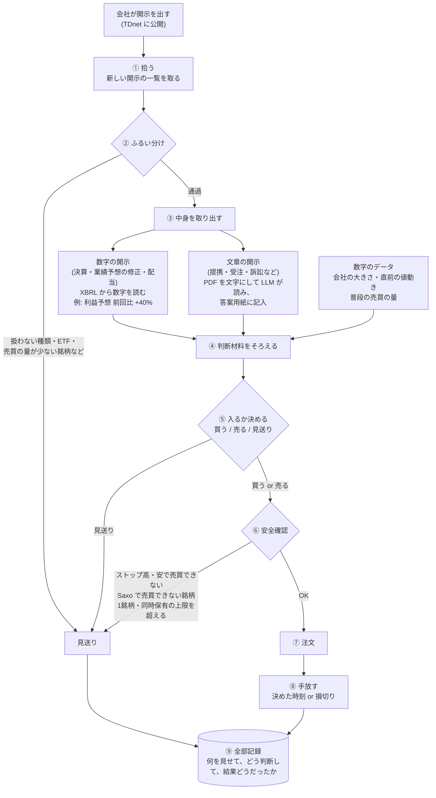
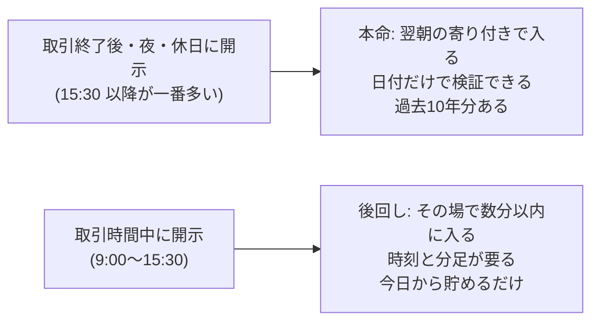
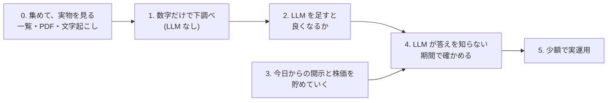

# 計画: 開示を読んでエントリーするまでの流れ

作成: 2026-10-31
この文書は「何を作ろうとしていて、どういう順番で確かめるか」を1か所で見渡すためのもの。
経緯や調査済みの事実は [HANDOFF.md](../HANDOFF.md) にある。ここで「案」と書いたものは、まだ決まっていない。

---

## 1. ひとことで

会社が適時開示を出す → 中身を読んで「良い話か悪い話か、どのくらい意外か」を判断する → 株価が動く前、または動いている途中に乗る。
これを、どの会社の開示にも**同じ手順**で当てはめて、1日に何十回も回す。

ポイントは**銘柄ごとに作戦を作るのではなく、開示1件ごとに同じ手順で判断する**こと。
会社ごとの違い (大きい会社か小さい会社か等) は、判断の「材料の一つ」として入るだけ。
同じ手順がどの銘柄にも同じように効くとは限らないので、結果は会社の大きさ別などに分けて見る。

---

## 2. エントリーまでの流れ (図)



### 各ステップで何をするか

| # | ステップ | やること | 担当 | まだ決まっていないこと |
|---|---|---|---|---|
| ① | 拾う | 開示の一覧を取ってくる。過去分は東証上場会社情報サービス、実運用では TDnet (§5) | 仕組み | — |
| ② | ふるい分け | 中身を読まずに、一覧の情報だけで大半を落とす (§3) | 仕組み | 残す種類、売買の量の基準 |
| ③ | 中身を取り出す | 数字は XBRL から読む。文章は PDF を文字にして LLM が読み、決まった答案用紙に記入する (= 構造化) | 数字: 仕組み / 文章: LLM | 答案用紙の項目、文字起こしの道具 (§6) |
| ④ | 材料をそろえる | ③の結果に、株価などの数字を足す | 仕組み | どの数字を使うか |
| ⑤ | 入るか決める | ④をもとに 買う / 売る / 見送り を決める | 仕組み (+ LLM) | 決め方そのもの。これを検証で固める |
| ⑥ | 安全確認 | 売買できない状態や、自分の注文で値段が動く銘柄を避ける。Saxo で売買できない銘柄はここで落とす | 仕組み | 上限の金額 |
| ⑦ | 注文 | Saxo に注文を出す | 仕組み | — |
| ⑧ | 手放す | 決めた時刻か、損切りの値段で手放す | 仕組み | いつ手放すか (案: その日の引け / 数日後) |
| ⑨ | 記録 | 見送りも含めて全部残す。後で答え合わせに使う | 仕組み | — |

### 答案用紙の例 (③で LLM に記入させるもの、案)

```
種類:              提携
良い話か悪い話か:   良い
意外さ:            5段階で 4
業績への影響:       金額の記載あり (年 X 億円)
もう織り込み済みか: 前から噂されていた形跡なし
```

形式が決まっていない文章でも、LLM に読ませて毎回同じ項目に記入させれば、表の形で比べられるようになる。

---

## 3. ② ふるい分けの詳細

開示は1日に数百件、決算の時期には千件を超える日もある。
ふるい分けは、それを「勝負する価値がありそうなもの」に減らす関所。目的は2つある。

- **LLM に読ませる量を減らす**: LLM は1件ごとに時間とお金がかかる
- **検証の対象をはっきりさせる**: 「どの開示を対象にしたか」が決まっていないと、後で比べられない

中身は読まない。一覧の情報 (日付・銘柄・題名・区分) だけで機械的に判断する。軽いものから順に当てる。

```
開示 (全部)
 │
 ├─ a. 訂正・取り消しか？ ──────→ 落とす (新しい材料ではない)
 ├─ b. 種類は扱うものか？ ──────→ 人事・日程のお知らせなどを落とす
 ├─ c. 普通の株か？ ────────────→ ETF・REIT・上場廃止が決まった銘柄を落とす
 ├─ d. 売買の量は十分か？ ──────→ 注文が薄すぎる銘柄を落とす
 ├─ e. 同じ会社の同時発表を1つに束ねる
 │
 ▼
③ 中身を取り出す へ   (落としたものも全部記録する)
```

**b. 種類は題名で振り分ける**
東証上場会社情報サービスには細かい種類のコードが無いので、題名の決まり文句で拾う。
例: 「業績予想の修正に関するお知らせ」「自己株式の取得に係る事項の決定に関するお知らせ」「剰余金の配当 (増配) に関するお知らせ」。
紛らわしいもの (「業績予想**及び配当予想**の修正」のように2種類が1つになったもの、「業績予想と実績値との**差異**」のように似て非なるもの) があるので、
**言葉のルールを作る → 振り分け結果を100件ほど目で確かめてルールを直す**。このとき見るのは振り分けの正しさだけで、株価は見ない。

**d. 売買の量**
案: 自分の注文が、その銘柄の普段の1日の売買代金の 1% 以下に収まること (1回 50万円なら、普段1日 5,000万円以上)。金額も 1% も仮。
普段の売買代金は、開示の**前の日までの**数字で計算する (開示の後は売買が急に増えるので、それを使うと楽観的になる)。

**e. 同時発表を束ねる**
15:30 に「決算短信」「増配」「自社株買い」を同じ会社がまとめて出すことがよくある。3回の勝負と数えると独立な回数を水増しするので、同じ日の同じ時間帯に出たものは1つの出来事として束ね、③では束ごとに読む。

### どの銘柄を対象にするか: 消えた会社も入れる

過去の検証で「今も上場している銘柄だけ」に絞ると、「2026年まで生き残る」という当時は知り得なかった情報で銘柄を選ぶことになる。
消えた会社には、倒産・業績悪化で消えた会社 (外すと結果が良く見える) と、買収 (TOB・MBO) で消えた会社 (外すと良い材料の大当たりが抜ける) の両方があり、外したときに結果がどちらにずれるかも分からない。なので推測で済ませず、入れておく。

| 見方 | 対象 | 役割 |
|---|---|---|
| **本命** | その当時に上場していて、d の条件を満たしていた銘柄 | 合否はこれで判定する |
| 追加1 | 今も上場している銘柄だけ | 本命との差で、消えた会社の影響の大きさが分かる |
| 追加2 | 今の Saxo の一覧 (1,344 銘柄) にある銘柄だけ | 実運用に近い見え方。過去に Saxo が扱っていた銘柄の一覧は無いので、参考扱い |

当時はなかったが今はある銘柄は、過去の期間に開示も株価も無いので、何もしなくても自然に対象外になる。

---

## 4. 入るタイミング: 本命は「翌朝の寄り付き」

東証の取引時間は 9:00〜11:30 と 12:30〜15:30 (日本時間)。



- **本命 (翌朝の寄り付きで入る)**: 過去の開示の一覧には日付しかないが、この検証には日付で足りる。取引時間中に出た開示も「翌朝入る」として測ればよく、未来の情報を使うことにはならない (当日中の値動きを取り逃がす扱いになるだけ)
- **後回し (取引時間中にその場で入る)**: 開示の時刻が要るが、時刻が取れるのは TDnet の閲覧サイトの直近1か月分だけ。今日から貯めても、判断できる量になるには何か月〜1年かかる。分足が Saxo で過去にどこまで取れるかも未確認。なので今は貯めるだけにして、本命で手応えが出てから考える

---

## 5. データをどこから取るか

| データ | 取り先 | 費用 | 中身・制約 |
|---|---|---|---|
| 過去の開示の一覧と PDF | [東証上場会社情報サービス](https://www2.jpx.co.jp/tseHpFront/JJK010010Action.do?Show=Show) | 無料 | 過去10年分。**日付のみで時刻なし**。区分 (決算情報 / 決定事実・発生事実 / その他 等)、PDF、決算短信は XBRL と文章の HTML 版も付く。上場廃止した会社は廃止後5年分だけ残る。毎日午前1時更新 |
| 直近の開示 (時刻つき) | [TDnet 適時開示情報閲覧サービス](https://www.release.tdnet.info/inbs/I_main_00.html) | 無料 | 直近31日分のみ。時:分 まで分かる。実運用で新しい開示を拾うのもこちら |
| 株価 (日足・分足) | Saxo | 東証データ Level1 月¥275 (2026-11-01 開始) | 何年遡れるか、上場廃止した銘柄も取れるかは 11/1 以降に確認 |
| 株価の予備 | J-Quants Light | 月¥1,650 | Saxo で足りない場合だけ |

J-Quants の適時開示アドオン (月¥11,000) は、費用が高いので使わない。

### 東証上場会社情報サービスからの取り方

実際に試して確認済み (2026-10-31、トヨタで1社分)。ブラウザ無しの普通のプログラムで取れる。

1. 検索ページで会社の一覧を取る (1ページ最大200社。上場廃止した会社は別の検索から)
2. 会社ごとのページを1回読み込むと、10年分の開示の一覧が全部入っている (トヨタは 2016-09〜2026-10 で 304件)
3. 一覧にある PDF の置き場所から、必要な PDF だけ取る

約4,500社 × 1回 = 約4,500回の読み込みで10年分の一覧がそろう (3秒おきで4時間弱)。

### 規約とお作法

- このサービスの「データ利用上の注意事項」に「東証は本サービスで公開している情報の利用を制限しておりません」とある
- JPX サイト全体の規約に「高頻度・高負荷に繋がる可能性のある自動取得等はご遠慮いただいております」とある
- なので、取り方は次のとおりにする
  - **ゆっくり取る**: 1件ごとに数秒あける。閲覧の少ない時間に回す
  - **必要な分だけ**: PDF は、ふるい分けで残した種類だけ取る
  - **自分だけで使う**: 取ったものは GitHub にも載せない (株価と同じ扱い)。開示の PDF の著作権は各社にある場合がある
  - **止められたら止める**: 拒否されたり注意が来たら、すぐやめて別の手段に切り替える

### データ量の見積もり

2日分の件数 (10/30: 832件、10/15: 521件) と PDF 10件の大きさから伸ばした概算。半分〜2倍くらいはずれうる。

| もの | 量 |
|---|---|
| 開示の件数 | 年10〜15万件、10年で100〜150万件 |
| 一覧 (整理した表) | 数百MB |
| PDF 全部 | 200〜600GB (取らない) |
| PDF のうち残す種類だけ | 10万件前後、10〜30GB |
| 文字にした本文 | 数GB |

---

## 6. 文字起こし

TDnet の PDF はほとんどがパソコンで作られたもの (スキャンではない) なので、中に文字のデータはある。
ただ、文字が画面の見た目どおりの順番で入っているとは限らない (表や2段組みが崩れる)。必要なのは画像から文字を読む OCR ではなく、**ページ上の位置を見て正しい順番に並べ直す**処理。

- **数字は PDF から取らない**: 決算短信などには数字を機械で読める形にした XBRL が付いているので、そこから読む
- **PDF の文字起こしは、文章を LLM に読ませる用途だけ**に使う。LLM は多少順番が崩れた文章でも読めるので、求める精度はそこまで高くない

| 道具 | 特徴 | 費用 |
|---|---|---|
| PyMuPDF (pymupdf4llm) | 速い (1件1秒以下)。読む順番を整え、表も含めて文章にする | 無料 |
| Docling | ページの配置や表の形を AI で読み取る。質は高いが遅い (1件数秒〜) | 無料 |

**進め方**: 残す種類の PDF を10件ほど選び、両方で文字にして結果を見比べてから決める。

---

## 7. システムの置き場所 (GCP)

- **FX の本番とは別の GCP プロジェクト**を作る (権限や費用が混ざって FX の本番に触れないように)
- 貯める一方で、分析のときにまとめて読む使い方なので、**GCS + BigQuery** にする。常時起動のサーバー (RDB) は使わない

```
JPX のサイト ──(ゆっくり取る)──→ GCS: PDF の原本をそのまま置く
                                    │
                                    ├─→ 文字起こし (PyMuPDF / Docling)
                                    │         │
                                    ▼         ▼
                               BigQuery: 開示の一覧 / 本文のテキスト
                                    │
                                    ▼
                               分析 (SQL、必要なら CSV に出す)
```

| 置くもの | 置き場所 | 費用の目安 |
|---|---|---|
| PDF の原本 (10〜30GB) | GCS、米国リージョン (us-central1)。最初は Standard、文字起こしの方法が固まったら Archive に自動で移す (ライフサイクル設定) | Standard は 5GB まで無料、超えた分は 30GB で月 ¥75 程度。Archive なら月 ¥5 程度 |
| 開示の一覧・本文のテキスト | BigQuery (米国) | 保存 10GiB/月・集計 1TiB/月 まで無料。この量なら無料枠内 |
| 取ってくる処理・文字起こし | Cloud Run のジョブ (1日1回) | ほぼ無料枠内。過去10年分を最初に Docling で文字にするときだけ数百〜千数百円。手元の Mac で回してもよい |
| 実運用の状態 (処理済みか、保有中か) | Firestore (後で) | 件数が少ないので無料枠内 |

- Archive は特別な手順なしに、普通のファイルと同じように取り出せる。ただし取り出しに費用がかかる (全部読み直すと1回 ¥1,000 程度) ので、やり直しの可能性がある間は Standard に置く
- GCS のバケットは公開しない
- 金額はすべて目安。作るときに公式の料金表で確認する

---

## 8. 確かめる順番

いきなり作って動かすのではなく、段階を踏んで「本当に当たるか」を確かめてから進む。



| 段階 | やること | なぜ |
|---|---|---|
| 0. 集めて、実物を見る | 10年分の一覧を集め、種類ごとの件数を数える。開示を種類別に読み、残す種類を決めて PDF を取り、文字にする | 何が書いてあるかを知らないと、答案用紙の項目もふるい分けも決められない |
| 1. 数字だけで下調べ | 「どの種類の開示の後に、どのくらい動くか」を測る。例: 「利益予想を30%以上引き上げた会社を翌朝買う」だけで儲かるか | LLM に頼らなくても取れる分を先に知っておく。これが LLM の比べる相手になる |
| 2. LLM を足す | 同じ開示を LLM に読ませ、1 より良くなるかを見る | LLM を使う意味があるかを確かめる |
| 3. 貯める (並行) | 毎日の開示 (時刻つき) と株価を保存するだけ。判断はさせない | 4 で使う材料。取引時間中の開示の検証にも使う |
| 4. 答えを知らない期間で確認 | 3 で貯めたデータで同じ検証をする | 下の「落とし穴」のため。最終判定はここ |
| 5. 少額で実運用 | 4 を通ったものだけ | — |

### 期間の分け方 (案)

調べ始める前に、宣言文書 (`research/<theme>/PREREG.md`) で固定する。

| 期間 | 範囲 (案) | 使い方 |
|---|---|---|
| 学習 | 2016-09 〜 2021-10 | 自由に見てルールを考える場所 (どの種類を使うか、どのくらいの修正率で入るか等)。消えた会社が一部抜けているが、考えるための材料なので許容する |
| 検証 | 2021-11 〜 2024-10 | 学習で決めたルールを、そのまま当てはめて確かめる |
| 金庫 | 2024-11 〜 2026-10 | 検証を通ったものだけ、最後に1回だけ開ける |

検証と金庫は、消えた会社まで全部そろっている直近5年の中に置く。

### 落とし穴: LLM は過去の答えを知っている

LLM は 2026年半ばまでのデータで学習しているので、過去の開示を見せると「この会社はこの後急騰した」と知った上で判断してしまう恐れがある。
そこで、2 では社名を伏せた形と伏せない形を比べて、どれだけ「知っている」かを測る。最後は 4 の、LLM が知らない期間の結果で判定する。

### 検証の作法 (FX で身についたもの)

- 調べる前に「何を、どの期間で、どうなったら合格か」を文書に書いて固定する。ユーザーの OK をもらってから結果を開ける
- 期間を **学習 → 検証 → 金庫** の3つに分ける。金庫は最後に1回だけ開ける
- 合格は「売買コストを引いても、ぶれの範囲の下の端がプラス」
- 銘柄や種類の絞り方は、**その時点で分かっていたこと**だけで決める (「大きく動いた銘柄」のような後から分かる基準で選ばない)

---

## 9. 決めること・確かめること

| 項目 | 案 | 状態 |
|---|---|---|
| 最初に残す開示の種類 | 2〜3種類。候補: 業績予想の修正、自社株買い、配当予想の修正。件数を数えて実物を見てから決める | 未決 |
| 売買の量の基準 | 普段の1日の売買代金の 1% 以下。1回の金額を決めてから計算する | 未決 |
| 文字起こしの道具 | PyMuPDF と Docling を10件で比べて決める | 未決 |
| 期間の分け方 | §8 の案 | 未決 (宣言文書で固定する) |
| 買いだけか、売りもか | 悪い話で売る方も Saxo なら可能。売りのコスト (貸株料) は未確認 | 未決 |
| GCP プロジェクト | FX とは別に作る (ユーザー側で作成、請求先の紐付け) | 未着手 |
| Saxo で確かめること (11/1 以降) | 日本株の分足が何年前まで取れるか / 売値と買値の両方があるか / **上場廃止した銘柄を検索で見つけられるか、株価が取れるか** | 未確認 |

---

## 用語メモ

- **適時開示**: 上場企業が株価に影響しそうなことを、決まった・起きた時点ですぐ公表する東証の義務。TDnet で全員に同時に公開される
- **寄り付き**: その日最初に付く値段 (9:00)。**引け**: その日最後の値段 (15:30)
- **ストップ高・安**: 1日に動ける値幅の上限・下限。張り付くと売買が成立しにくい
- **日足 / 分足**: 1日ごと / 1分ごとの株価の記録
- **構造化**: 決まった形式のない文章から、毎回同じ項目を取り出して表の形にすること
- **XBRL**: 決算などの数字を、機械で読める形にした添付ファイル
- **BigQuery**: Google の分析用データベース (データウェアハウス)。常時起動のサーバーが無く、保存量と読んだ量だけ課金
- **GCS (Cloud Storage)**: Google のファイル置き場。Archive は、めったに読まないファイル向けの安い置き方
