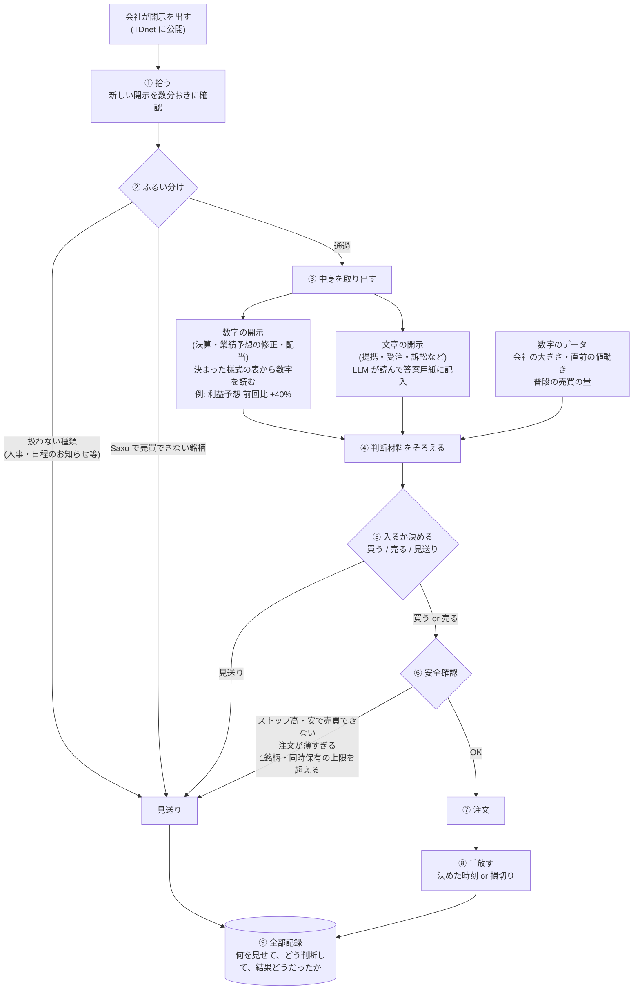
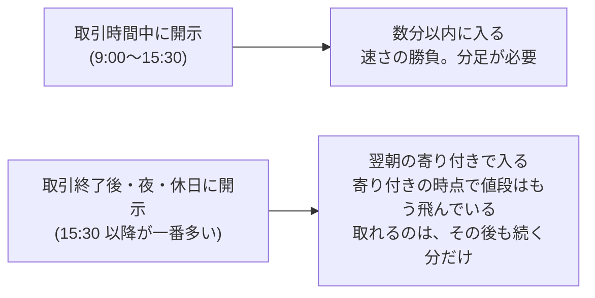
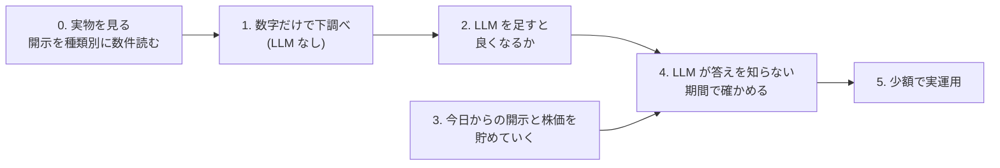

# 計画: 開示を読んでエントリーするまでの流れ

作成: 2026-10-31
この文書は「何を作ろうとしていて、どういう順番で確かめるか」を1か所で見渡すためのもの。
経緯や調査済みの事実は [HANDOFF.md](../HANDOFF.md) にある。ここに書いた中身のうち「案」とあるものは、まだ決まっていない。

---

## 1. ひとことで

会社が適時開示を出す → 中身を読んで「良い話か悪い話か、どのくらい意外か」を判断する → 株価が動く前、または動いている途中に乗る。
これを、どの会社の開示にも**同じ手順**で当てはめて、1日に何十回も回す。

ポイントは**銘柄ごとに作戦を作るのではなく、開示1件ごとに同じ手順で判断する**こと。
会社ごとの違い (大きい会社か小さい会社か等) は、判断の「材料の一つ」として入るだけ。

---

## 2. エントリーまでの流れ (図)



### 各ステップで何をするか

| # | ステップ | やること | 担当 | まだ決まっていないこと |
|---|---|---|---|---|
| ① | 拾う | 新しい開示の一覧を取ってくる | 仕組み | 実運用で J-Quants を使うか TDnet を直接見るか (J-Quants は混雑時に最大1時間ほど遅れる) |
| ② | ふるい分け | 扱う種類か、売買できる銘柄かを見て、大半を落とす | 仕組み | どの種類から始めるか |
| ③ | 中身を取り出す | 数字の開示は表から数字を読む。文章の開示は LLM が読んで、決まった答案用紙に記入する (= 構造化) | 数字: 仕組み / 文章: LLM | 答案用紙の項目 |
| ④ | 材料をそろえる | ③の結果に、株価などの数字を足す | 仕組み | どの数字を使うか |
| ⑤ | 入るか決める | ④をもとに 買う / 売る / 見送り を決める | 仕組み (+ LLM) | 決め方そのもの。これを検証で固める |
| ⑥ | 安全確認 | 売買できない状態や、自分の注文で値段が動く銘柄を避ける | 仕組み | 上限の金額 |
| ⑦ | 注文 | Saxo に注文を出す | 仕組み | — |
| ⑧ | 手放す | 決めた時刻か、損切りの値段で手放す | 仕組み | いつ手放すか (案: その日の引け / 数日後) |
| ⑨ | 記録 | 見送りも含めて全部残す。後で答え合わせに使う | 仕組み | — |

### 答案用紙の例 (③で LLM に記入させるもの、案)

```
種類:              提携
良い話か悪い話か:   良い
意外さ:            5段階で 4
業績への影響:       金額の記載あり (年 X 億円)
もう織り込み済みか: 前から噂されていた形跡なし
```

形式が決まっていない文章でも、LLM に読ませて毎回同じ項目に記入させれば、表の形で比べられるようになる。

---

## 3. 開示が出た時刻で、入るタイミングが変わる

東証の取引時間は 9:00〜11:30 と 12:30〜15:30 (日本時間)。



- 決算の多くは 15:30 前後に出るので、**数として多いのは下段**。日足 (1日1本の株価) だけで過去を検証できるので、最初はここから測る
- 上段は分足 (1分ごとの株価) が要る。Saxo で取れるかは、東証データの契約 (2026-11-01 開始) の後に確認する

---

## 4. 確かめる順番

いきなり作って動かすのではなく、段階を踏んで「本当に当たるか」を確かめてから進む。



| 段階 | やること | なぜ |
|---|---|---|
| 0. 実物を見る | 開示を種類別に数件、手で開いて読む | 何が書いてあるかを知らないと、答案用紙の項目も決められない |
| 1. 数字だけで下調べ | 「どの種類の開示の後に、どのくらい動くか」を過去5年分で測る。例: 「利益予想を30%以上引き上げた会社を翌朝買う」だけで儲かるか | LLM に頼らなくても取れる分を先に知っておく。これが LLM の比べる相手になる |
| 2. LLM を足す | 同じ開示を LLM に読ませ、1 より良くなるかを見る | LLM を使う意味があるかを確かめる |
| 3. 貯める (並行) | 毎日の開示と株価を保存するだけ。判断はさせない | 4 で使う材料 |
| 4. 答えを知らない期間で確認 | 3 で貯めたデータで同じ検証をする | 下の「落とし穴」のため。最終判定はここ |
| 5. 少額で実運用 | 4 を通ったものだけ | — |

### 落とし穴: LLM は過去の答えを知っている

LLM は 2026年半ばまでのデータで学習しているので、過去の開示を見せると「この会社はこの後急騰した」と知った上で判断してしまう恐れがある。
そこで、2 では社名を伏せた形と伏せない形を比べて、どれだけ「知っている」かを測る。最後は 4 の、LLM が知らない期間の結果で判定する。

### 検証の作法 (FX で身についたもの)

- 調べる前に「何を、どの期間で、どうなったら合格か」を文書に書いて固定する。ユーザーの OK をもらってから結果を開ける
- 期間を **学習 → 検証 → 金庫** の3つに分ける。金庫は最後に1回だけ開ける
- 合格は「売買コストを引いても、ぶれの範囲の下の端がプラス」
- 銘柄や種類の絞り方は、**その時点で分かっていたこと**だけで決める (「大きく動いた銘柄」のような後から分かる基準で選ばない)

---

## 5. データをどこから取るか

| データ | 取り先 | 費用 | 状態 |
|---|---|---|---|
| 開示の一覧・本文 PDF・数字の添付 (過去5年) | J-Quants 適時開示アドオン | Light 月¥1,650 + アドオン 月¥11,000 | 未契約 |
| 株価の日足 (過去5年) | J-Quants Light | 上に含まれる | 未契約 |
| 株価の分足 | Saxo | 東証データ Level1 月¥275 | 2026-11-01 開始予定。何年遡れるかは未確認 |
| 開示を手で見る (過去10年) | 東証上場会社情報サービス | 無料 | 人の手で見るだけなら使える。プログラムでまとめて取るのは JPX サイトの規約に反する |

---

## 6. 決めること

| 項目 | 案 | 状態 |
|---|---|---|
| 最初に扱う銘柄 | Saxo で売買できる 1,344 銘柄 (売買できなければ勝てても意味がないため)。手応えが出たら外にも広げる | 未決 |
| 最初に扱う開示の種類 | 2〜3種類。数字で中身が分かる「業績予想の修正」と、文章だが項目の決まった「自社株買い」など。0 で実物を見てから決める | 未決 |
| J-Quants の契約 | Light + 適時開示アドオン。1か月だけ契約してまとめて取る案もある (解約後もデータを使ってよいかは申込前に規約を確認する) | 未決 |
| 買いだけか、売りもか | 悪い話で売る方も Saxo なら可能。ただし売りのコスト (貸株料) は未確認 | 未決 |

---

## 用語メモ

- **適時開示**: 上場企業が株価に影響しそうなことを、決まった・起きた時点ですぐ公表する東証の義務。TDnet で全員に同時に公開される
- **寄り付き**: その日最初に付く値段 (9:00)。**引け**: その日最後の値段 (15:30)
- **ストップ高・安**: 1日に動ける値幅の上限・下限。張り付くと売買が成立しにくい
- **日足 / 分足**: 1日ごと / 1分ごとの株価の記録
- **構造化**: 決まった形式のない文章から、毎回同じ項目を取り出して表の形にすること
