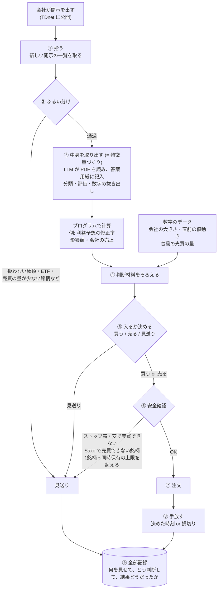
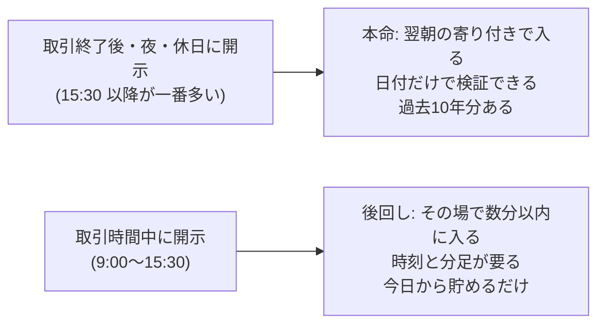
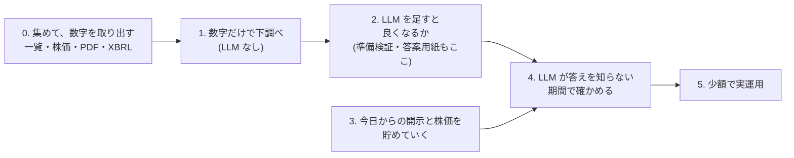

# 計画: 開示を読んでエントリーするまでの流れ

作成: 2026-10-31
この文書は「何を作ろうとしていて、どういう順番で確かめるか」を1か所で見渡すためのもの。
経緯や調査済みの事実は [HANDOFF.md](../HANDOFF.md) にある。ここで「案」と書いたものは、まだ決まっていない。

> **2026-11-03 追記: 読む先を TDnet の外に広げる。** TDnet の開示に乗る形は秒の勝負で、翌朝の寄り付き (§4 の本命) にも反応は入りきっていた
> (段階1〜2b、取引時間中のティック、引け後の文章の知らせ。[research/explore_notes.md](../research/explore_notes.md))。
> これからは、TDnet より先に出る公開情報 (省庁の採択一覧、海外の提携先の発表、学会の要旨など) を LLM に集めさせ、上場会社に結びつけて先回りする。
> 情報源ごとに1つのロジックとして重ねる。この文書の流れ (ふるい分け → 中身を取り出す → 入るか決める) は、入口を「開示」から「情報源ごとの発表」に替えて使う。
> 詳しくは HANDOFF.md の 2026-11-03 追記。

---

## 1. ひとことで

会社が適時開示を出す → 中身を読んで「良い話か悪い話か、どのくらい意外か」を判断する → 株価が動く前、または動いている途中に乗る。
これを、どの会社の開示にも**同じ手順**で当てはめて、1日に何十回も回す。

ポイントは**銘柄ごとに作戦を作るのではなく、開示1件ごとに同じ手順で判断する**こと。
会社ごとの違い (大きい会社か小さい会社か等) は、判断の「材料の一つ」として入るだけ。
同じ手順がどの銘柄にも同じように効くとは限らないので、結果は会社の大きさ別などに分けて見る。

**一番大事なのは、FX より独立な勝負をたくさんできること** (§7)。売買の回数が多くても、一緒に動く勝負ばかりなら意味がない。

### 株ならではのルールと偏り (この文書で扱うもの)

| こと | 何が問題か | どこで扱うか |
|---|---|---|
| 消えた会社 | 今ある銘柄だけで検証すると結果がずれる | §3 |
| 同じ会社の同時発表 | 1つの出来事を何回にも数えてしまう | §3 |
| アナリストの予想の有無 | 大きい会社は期待との差で動く。小さい会社は会社自身の予想が基準 | §3 |
| 開示の時刻 | 多くは取引終了後に出て、翌朝の寄り付きで値段がもう飛んでいる | §4 |
| ストップ高・安 | 一番おいしい候補ほど買えない | §4 |
| 決算の時期への集中 | ピークの日は候補が多すぎて全部は入れない | §7 |
| 同じ日・同じ業種の連動 | 独立な勝負の回数が見かけより少なくなる | §7 |
| 寄り付き・引けのオークション | 値段の決まり方が取引時間中と違う (バックテストではむしろ測りやすい) | §9 |
| コストと値動きの比 | 株は USDJPY よりコストが安いわけではない | §9 |
| 株式分割・配当の権利落ち | 補正しないと大損・値下がりに見える | §9 |
| 相場全体の上げ下げ・暴落 | 上げ相場では買いの作戦が実力以上に良く見える。暴落の日は全部一緒に負ける | §10 |

---

## 2. エントリーまでの流れ (図)



### 各ステップで何をするか

| # | ステップ | やること | 担当 | まだ決まっていないこと |
|---|---|---|---|---|
| ① | 拾う | 開示の一覧を取ってくる。過去分は東証上場会社情報サービス、実運用では TDnet (§5) | 仕組み | — |
| ② | ふるい分け | 中身を読まずに、一覧の情報だけで大半を落とす (§3) | 仕組み | 残す種類、売買の量の基準 |
| ③ | 中身を取り出す | LLM が PDF を読み、決まった答案用紙に記入する (= 構造化、特徴量づくり)。数字での計算はプログラムでやる | 読む: LLM / 計算: 仕組み | 答案用紙の項目、文字起こしの道具、モデル (§6) |
| ④ | 材料をそろえる | ③の結果に、株価などの数字を足す | 仕組み | どの数字を使うか |
| ⑤ | 入るか決める | ④をもとに 買う / 売る / 見送り を決める | ルール or 機械学習。LLM は比べる候補 (§7) | 決め方そのもの。これを検証で固める |
| ⑥ | 安全確認 | 売買できない状態や、自分の注文で値段が動く銘柄を避ける。Saxo で売買できない銘柄はここで落とす | 仕組み | 上限の金額 |
| ⑦ | 注文 | Saxo に注文を出す | 仕組み | — |
| ⑧ | 手放す | 決めた時刻か、損切りの値段で手放す | 仕組み | いつ手放すか (案: その日の引け / 数日後) |
| ⑨ | 記録 | 見送りも含めて全部残す。後で答え合わせに使う | 仕組み | — |

### 答案用紙の例 (③で LLM に記入させるもの、案)

```
種類:              提携
良い話か悪い話か:   良い
意外さ:            5段階で 4
業績への影響:       金額の記載あり (年 X 億円)
もう織り込み済みか: 前から噂されていた形跡なし
```

形式が決まっていない文章でも、LLM に読ませて毎回同じ項目に記入させれば、表の形で比べられるようになる。

---

## 3. ② ふるい分けの詳細

開示は1日に数百件、決算の時期には千件を超える日もある。
ふるい分けは、それを「勝負する価値がありそうなもの」に減らす関所。目的は2つある。

- **LLM に読ませる量を減らす**: LLM は1件ごとに時間とお金がかかる
- **検証の対象をはっきりさせる**: 「どの開示を対象にしたか」が決まっていないと、後で比べられない

中身は読まない。一覧の情報 (日付・銘柄・題名・区分) だけで機械的に判断する。軽いものから順に当てる。

```
開示 (全部)
 │
 ├─ a. 訂正・取り消しか？ ──────→ 落とす (新しい材料ではない)
 ├─ b. 種類は扱うものか？ ──────→ 人事・日程のお知らせなどを落とす
 ├─ c. 普通の株か？ ────────────→ ETF・REIT・上場廃止が決まった銘柄を落とす
 ├─ d. 売買の量は十分か？ ──────→ 注文が薄すぎる銘柄を落とす
 ├─ e. 同じ会社の同時発表を1つに束ねる
 │
 ▼
③ 中身を取り出す へ   (落としたものも全部記録する)
```

**b. 種類は題名で振り分ける**
東証上場会社情報サービスには細かい種類のコードが無いので、題名の決まり文句で拾う。
例: 「業績予想の修正に関するお知らせ」「自己株式の取得に係る事項の決定に関するお知らせ」「剰余金の配当 (増配) に関するお知らせ」。
紛らわしいもの (「業績予想**及び配当予想**の修正」のように2種類が1つになったもの、「業績予想と実績値との**差異**」のように似て非なるもの) があるので、
**言葉のルールを作る → 振り分け結果を100件ほど目で確かめてルールを直す**。このとき見るのは振り分けの正しさだけで、株価は見ない。
実際、トヨタで「差異」を業績予想の修正として拾ったら、「子会社の個別業績の差異」が混ざった。

**種類の振り分け (2026-11-01、全社10年分の一覧で作成)**
決まりは `src/alchemy_stock/screening.py`。結果は `scripts/screen_disclosures.py` で作る。1つの開示に複数の種類が付くことがある (「業績予想及び配当予想の修正」など)。

- 全649,877件 (同じ開示が2つの区分に載っているものは1件に数えた)。題名の言い回しは約10万通り
- 無作為に100件を目で確かめた: 種類まで合っていたのは96件。外れた4件は、対象外の中の付け間違い3件 (株式報酬が「人事」に入る等) と未分類1件で、**候補かどうかの判断はすべて合っていた**。外れた分は決まりを直した
- 何にも当たらない「未分類」は約1.9万件 (3%)。言い回しが1社だけのものが多い

| まとまり | 種類 | 1年あたり (2017〜2025、会社×日) |
|---|---|---|
| 候補 | 決算短信 | 14,581 |
| 候補 | 業績予想の修正 (公表を含む) | 3,842 |
| 候補 | 配当予想の修正 (増配・減配・無配・復配) | 2,040 |
| 候補 | 買収・事業の売り買い (子会社化・合併・株式交換・事業譲渡) | 1,493 |
| 候補 | 業績予想と実績の差異 | 1,249 |
| 候補 | 自社株買いの決定 | 1,020 |
| 候補 | 不祥事・訴訟・延期 (災害・不正アクセス・債務超過なども含む) | 903 |
| 候補 | 増資・新株予約権 | 674 |
| 候補 | 提携 (資本業務提携・業務提携・合弁) | 553 |
| 候補 | 株主優待 (導入・変更・廃止) | 527 |
| 候補 | 売出し・立会外分売 | 266 |
| 候補 | 公開買付け (TOB・MBO) | 184 |
| 候補 | 株式分割 | 178 |
| 候補 | 決算の速報 (決算短信の前に出す概算) | 71 |
| 保留 | 特別な損益 / 月次の売上 / 事業の知らせ (受注・承認・治験など) / 中期計画・還元方針 / 上場・市場区分 / 資産の売り買い / 自己株式の消却 / 前期実績との差異 / 株式併合 / 報道への回答 / 未分類 | — |
| 付随 | 決算の補足資料 (説明資料・質疑応答など。決算短信と束ねる) | — |
| 対象外 | 人事・組織 / 手続き・ガバナンス / 配当の決定 (予想どおりの正式決定) / 自社株買い・増資・売出し・公開買付けの経過 (状況・結果・終了) / グループ内の再編 / 借入・社債 | — |

- 「保留」は件数と中身を見てから候補に入れるか決める。特別な損益は業績予想の修正と同じ日に出ることが多く、束ねると候補の側に入る
- 公開買付けには「当社が買われる側」と「他社を買う側」の両方が混ざっている。値段が大きく動くのは買われる側なので、③で見分ける
- 自社株買いは「決定」だけを候補にした。「状況」「結果」「終了」と、決めた分の実行を知らせる立会外買付け (ToSTNeT-3) は経過として落とす

**決算短信も候補に入れる (方向)**
大きい会社では、決算はアナリストの予想の平均 (コンセンサス) と比べて評価され、「好決算なのに期待に届かず売られる」ことがよくある。アナリストの予想は有料データにしかないので、私たちには使えない。
一方、小さい会社にはアナリストがほとんど付いておらず、比べる相手は**会社自身の予想** (期初の予想と比べてどうか)、**進み具合** (半年で年間予想の何割か)、**来期の予想** (前の期より強気か弱気か) になる。どれも開示の中だけで測れる。
決算短信を入れると勝負の回数が倍以上になる (下の表)。最終的には全社の一覧で件数を確かめてから決める。

**d. 売買の量**
案: 自分の注文が、その銘柄の普段の1日の売買代金の 1% 以下に収まること (1回 50万円なら、普段1日 5,000万円以上)。金額も 1% も仮。
普段の売買代金は、開示の**前の日までの**数字で計算する (開示の後は売買が急に増えるので、それを使うと楽観的になる)。

2026-11-02: **開示の日より前の20営業日の平均売買代金が 0.5億円以上** で PDF を取る範囲を決めた (`src/alchemy_stock/liquidity.py`、表は `scripts/liquidity_table.py`)。広めに取っておけば、検証で基準を厳しくしても取り直さなくてよい。本番の基準は検証の宣言文書で固定する。

| 20日平均の売買代金 (2021-11〜2025) | 出来事/年 | うち短信以外を含む/年 | 社数 |
|---|---|---|---|
| 基準なし | 21,464 | 11,134 | 4,161 |
| 0.1億円以上 | 16,063 | 8,650 | 3,895 |
| 0.3億円以上 | 12,747 | 7,012 | 3,542 |
| **0.5億円以上 (採用)** | **10,919** | **6,078** | **3,297** |
| 1億円以上 | 8,433 | 4,778 | 2,829 |
| 3億円以上 | 5,179 | 3,036 | 1,912 |
| 10億円以上 | 2,813 | 1,693 | 1,060 |

- 2017〜2021-10 もほぼ同じ形 (0.5億円以上で 10,493件/年)。ただし上場廃止した会社が一部抜けている
- 10億円以上でも年2,800件残る。⑤の目安 (年1,000回前後) を絞るのは、売買の量ではなく資金の上限と順位付け
- 前の日の株価が無い出来事は 0.9% (上場した日やその前の開示)。自然に対象外

**e. 同時発表を束ねる**
15:30 に「決算短信」「増配」「自社株買い」を同じ会社がまとめて出すことがよくある。3回の勝負と数えると独立な回数を水増しするので、同じ日の同じ時間帯に出たものは1つの出来事として束ね、③では束ごとに読む。

### どの銘柄を対象にするか: 消えた会社も入れる

過去の検証で「今も上場している銘柄だけ」に絞ると、「2026年まで生き残る」という当時は知り得なかった情報で銘柄を選ぶことになる。
消えた会社には、倒産・業績悪化で消えた会社 (外すと結果が良く見える) と、買収 (TOB・MBO) で消えた会社 (外すと良い材料の大当たりが抜ける) の両方があり、外したときに結果がどちらにずれるかも分からない。なので推測で済ませず、入れておく。

| 見方 | 対象 | 役割 |
|---|---|---|
| **本命** | その当時に上場していて、d の条件を満たしていた銘柄 | 合否はこれで判定する |
| 追加1 | 今も上場している銘柄だけ | 本命との差で、消えた会社の影響の大きさが分かる |
| ~~追加2~~ | ~~今の Saxo の一覧 (1,344 銘柄) にある銘柄だけ~~ | 2026-11-02 に Saxo をやめ、現物で売買する方針にしたので不要 (§5) |
| 追加2 | 売り: その日に貸借銘柄だった銘柄だけ | 売りから入れたかを、J-Quants の日付ごとの貸借の区分で判定する (今の区分で過去を判定しない) |

当時はなかったが今はある銘柄は、過去の期間に開示も株価も無いので、何もしなくても自然に対象外になる。

### 舞台に上がる回数の見積もり

2026-10-31 に10社 (トヨタ + 市場ごとにくじで3社ずつ) の10年分を題名で数えた。くじは各市場の一覧の1ページ目 (コードの若い200社) から引いたので、建設・食品などの古い会社に寄っている。

| 会社 | 市場 | 期間 | 開示の総数 | 決算短信 | 業績予想の修正 | 予想と実績の差異 | 配当の修正 | 自社株買い | 4種を同日で束ねた数 | 1年あたり |
|---|---|---|---|---|---|---|---|---|---|---|
| トヨタ自動車 | プライム | 10年 | 304 | 43 | 3 | 0 | 2 | 19 | 22 | 2.2 |
| 日比谷総合設備 | プライム | 10年 | 273 | 55 | 16 | 0 | 4 | 10 | 24 | 2.4 |
| 関電工 | プライム | 10年 | 133 | 59 | 4 | 0 | 6 | 1 | 9 | 0.9 |
| 味の素 | プライム | 10年 | 236 | 54 | 19 | 2 | 1 | 10 | 24 | 2.4 |
| ガーデン | スタンダード | 1.9年 | 76 | 8 | 2 | 0 | 4 | 0 | 5 | 2.6 |
| 湖池屋 | スタンダード | 10年 | 100 | 40 | 5 | 1 | 4 | 0 | 9 | 0.9 |
| 住石HD | スタンダード | 10年 | 200 | 41 | 22 | 2 | 4 | 6 | 30 | 3.0 |
| GMO プロダクトプラットフォーム | グロース | 10年 | 179 | 40 | 9 | 1 | 4 | 1 | 14 | 1.4 |
| ニッソウ | グロース | 4.3年 | 79 | 17 | 7 | 4 | 0 | 0 | 11 | 2.6 |
| INGS | グロース | 2.1年 | 61 | 9 | 0 | 0 | 2 | 0 | 1 | 0.5 |

(「4種」は決算短信を除いた4種類。決算短信が年4回より多い会社は、英語版や補足資料が混ざっている。)

- 決算短信を除く4種で、1社あたり年約2回 (束ねた後)。会社による差が大きい (年0.5〜3回)。自社株買いは大きい会社に偏る
- 決算短信を入れると、1社あたり年4〜5回 (束ねた後)
- 上場は約3,700社 (2026-10-31 時点でプライム 1,546 / スタンダード 1,550 / グロース 590)。決算短信込みで**年1万5千回前後**、売買の量で半分落とすと**年8,000回前後**が舞台に上がる
- 10社からの概算なので、半分〜2倍はずれうる。全社の一覧を集めたら数え直す

**全社で数え直した結果 (2026-11-01)**: a (訂正)・b (上の表の候補)・c (普通の株)・e (同じ会社の同じ日を束ねる) を当てた後の、1年あたりの出来事の数。d (売買の量) はまだ当てていない。

| 年 | 決算短信込み | 決算短信なし |
|---|---|---|
| 2017 | 18,929 | 9,064 |
| 2019 | 19,579 | 9,151 |
| 2021 | 21,286 | 11,445 |
| 2023 | 21,226 | 10,785 |
| 2025 | 21,876 | 11,595 |

- 決算短信込みで**年2万前後**。10社からの見積もり (1万5千) の1.4倍で、見積もりの幅の中。候補の種類を4種から14種に広げた分も入っている
- d で半分落とすと、決算短信込みで年1万前後、なしで年5,500前後
- 2021年10月より前は、上場廃止した会社の分が抜けている (東証上場会社情報サービスは廃止後5年分だけ)。2017〜2020年の数は実際より少し少ない

---

## 4. 入るタイミング: 本命は「翌朝の寄り付き」

東証の取引時間は 9:00〜11:30 と 12:30〜15:30 (日本時間)。



- **本命 (翌朝の寄り付きで入る)**: 過去の開示の一覧には日付しかないが、この検証には日付で足りる。取引時間中に出た開示も「翌朝入る」として測ればよく、未来の情報を使うことにはならない (当日中の値動きを取り逃がす扱いになるだけ)
- **後回し (取引時間中にその場で入る)**: 開示の時刻が要るが、時刻が取れるのは TDnet の閲覧サイトの直近1か月分だけ。今日から貯めても、判断できる量になるには何か月〜1年かかる。分足が Saxo で過去にどこまで取れるかも未確認。なので今は貯めるだけにして、本命で手応えが出てから考える

### ストップ高・安の扱い (検証で)

東証は、前の日の終値を基準に、1日に動いてよい値段の幅を銘柄ごとに決めている (おおよそ ±20〜30%)。上限まで上がった状態がストップ高、下限まで下がった状態がストップ安。

| 前の日の終値 | 1日に動ける幅 | 今日の値段の範囲 |
|---|---|---|
| 500円 | ±100円 | 400〜600円 |
| 1,000円 | ±300円 | 700〜1,300円 |
| 3,000円 | ±700円 | 2,300〜3,700円 |

大きな良い材料が出た小さい会社は、翌朝「買いたい」が殺到して上限でも売り手がおらず、**値段が付かないまま張り付く**ことがよくある。一番おいしい候補ほど買えない。張り付いた後の展開は3通り。

1. 一日中張り付いたまま。引けで、上限の値段の買い注文に少ない売りを配る (比例配分)。まず証券会社ごとに配り、各社がお客に配る (抽選が多い)。**注文の早さは関係ない**
2. 途中で利益確定の売りが出て、上限の値段で取引が成立する
3. 成立した後、売りが増えて上限から離れ、普通の取引に戻る

翌日は前日の上限の値段を基準に新しい幅が決まるが、その値段で買えるわけではない。翌日に買うのは、もう上がった値段から乗ることになる。

**検証での扱い**
- **始値がストップ高の値段と同じ日は「買えなかった」とみなす**。日足だと、13:00 に初めて上限で成立した日も「始値 = 上限」になり、9:00 に買えたと勘違いするため。9:00 にたまたま上限で寄り付いた日も含まれてしまうが、安全側に倒す
- ストップ安も同じで、始値がストップ安の値段と同じ日は「売れなかった」とみなす。手放すときは、張り付きが解けた最初の日の値段で手放したとして計算する
- 分足があれば、最初の1分足の時刻で 1 と 2 を見分けられる。ただし、Saxo の分足が実際の取引の記録 (出来高つき) か、気配の記録かを確かめてから使う
- 上限の値段で成立していても、自分の注文が通ったかは分からない (買いの方が多いため)。ここは常に「買えなかった」側に倒す

**重さの違い**: 買いたいときのストップ高は取り逃がすだけ (お金は減らない。困るのは検証で数えてしまうこと)。手放したいときのストップ安は、売れずに損が膨らむ (**実際にお金が減る**)。

---

## 5. データをどこから取るか

| データ | 取り先 | 費用 | 中身・制約 |
|---|---|---|---|
| 過去の開示の一覧と PDF | [東証上場会社情報サービス](https://www2.jpx.co.jp/tseHpFront/JJK010010Action.do?Show=Show) | 無料 | 過去10年分。**日付のみで時刻なし**。区分 (決算情報 / 決定事実・発生事実 / その他 等)、PDF、決算短信は XBRL と文章の HTML 版も付く。上場廃止した会社は廃止後5年分だけ残る。毎日午前1時更新 |
| 直近の開示 (時刻つき) | [TDnet 適時開示情報閲覧サービス](https://www.release.tdnet.info/inbs/I_main_00.html) | 無料 | 直近31日分のみ。時:分 まで分かる。実運用で新しい開示を拾うのもこちら |
| ~~株価 (日足・分足)~~ | ~~Saxo~~ | ~~東証データ Level1 月¥275~~ | 2026-11-02 にやめた (下の「Saxo をやめた理由」) |
| 株価 (日足) と銘柄の一覧 | [J-Quants](https://jpx-jquants.com/) (JPX 公式) | 最初の1か月はスタンダード 月¥3,300 で10年分を取り、その後ライト 月¥1,650 で続ける | 日付を指定すると、その日に売買のあった全銘柄が返る。**上場廃止した銘柄も入る** (廃止の前日まで)。分割の補正前・補正後の値段と倍率、売買代金、時価総額、値幅制限の上限・下限つき。銘柄の一覧は日付ごとで、市場・業種・規模・**貸借の区分 (その日に売りから入れたか)** が分かる。分足は別料金 (月¥5,500) なので当面使わない |
| 売買 | **Interactive Brokers (IBSJ) の TWS API** ([IBKR.md](IBKR.md)、2026-11-05 にユーザーと決定)。**kabuステーション API は使わない** (画面のある Windows のアプリを開いたままにする必要があり、Windows Server のクラウドでは入らない・リモートの画面を閉じると止まるという報告があり、物理の機械は持たない方針のため)。IB Gateway は Linux で画面なしで動かせる。以下の kabu の記述は経緯として残す | API も手数料も無料 (SOR 指定) | 現物と信用取引。2026-05-18 から、市場に SOR を指定した注文は現物・信用とも手数料無料で、API からも寄成・引成を SOR で出せる。弱点は Windows のアプリ (kabuステーション) を立ち上げておく必要があること。口座を開くのは検証で手応えが出てから。発注の部分は差し替えられる作りにする。立花証券 e支店は 2026-10-23 から API が「当分の間」停止 (PHP問題、再開未定) |

J-Quants の適時開示アドオン (月¥11,000) は、費用が高いので使わない。

#### Saxo をやめた理由 (2026-11-02)

API で東証の値段が取れるようになったので確かめた (日足は 2003〜2005年から、分割の補正済み、出来高つき、20分遅れ)。ただし次の3つで、検証にも売買にも足りないと判断した。
- 東京の株は **CFD の1,344銘柄だけ** (現物は0)。東証の上場株の3分の1ほど
- **上場廃止した銘柄が無い** (東芝などが検索に出ない)。過去の検証が「生き残った会社だけ」になる。TOB で買われる側の会社は、たいてい後で廃止されるので抜け落ちる
- 1分足の始まりが銘柄ごとにばらばら (トヨタは2016年以前から、さくらインターネットは2024年3月から)

#### J-Quants の規約で気をつけること

- 個人の私的利用だけ。取ったデータそのものを人に見せたり配ったりしない (分析の結果や手法の公開は可)
- 解約したら、取ったデータと複製をすべて消す (第7条)。研究から運用までは契約を続ける
- スタンダードからライトに下げた後も10年分を使い続ける点は、規約に明記が無い (下げる時の扱いが書かれていない)。ユーザーの判断で使い続ける (2026-11-02)
- 回数の上限は1分あたり 無料 5 / ライト 60 / スタンダード 120 回。無料プランは直近12週を除く2年分で、1年で自動解約

### 東証上場会社情報サービスからの取り方

ブラウザ無しの普通のプログラムで取れる。仕組みは `scripts/collect_jpx_listed.py` (使い方は README)。

1. 検索ページで会社の一覧を取る (1ページ最大200社)。2026-11-01 時点で上場中 3,686社 (プライム 1,546 / スタンダード 1,550 / グロース 590)、上場廃止 581社 (ETF 等を含む、廃止後5年分)
2. 会社ごとのページを1回読み込むと、10年分の開示の一覧が全部入っている (トヨタは 2016-10〜2026-10 で 302件)。上場廃止した会社のページは区分の番号の体系が違い (5101〜)、上場廃止日も載る
3. 一覧にある PDF の置き場所から、必要な PDF だけ取る

約4,300社 × 1回 = 約4,300回の読み込みで10年分の一覧がそろう (3秒おきで3時間半ほど)。

TDnet の一覧 (`scripts/collect_tdnet.py`) とは、PDF のファイル名 (`doc_id`) が同じ番号なので突き合わせられる。直近31日分については、TDnet 側から時刻を付けられる。

### 規約とお作法

- このサービスの「データ利用上の注意事項」に「東証は本サービスで公開している情報の利用を制限しておりません」とある
- JPX サイト全体の規約に「高頻度・高負荷に繋がる可能性のある自動取得等はご遠慮いただいております」とある
- なので、取り方は次のとおりにする
  - **ゆっくり取る**: 1件ずつ順番に (並列にしない)。会社のページ (検索の仕組みを通る重いページ) は3秒おき、PDF (置いてあるファイルを渡すだけの軽いもの) は1秒おき。閲覧の少ない時間に回す
    - 2026-11-02 変更 (ユーザーの判断): PDF・XBRL の全件取得は **3本並列、それぞれ1秒おき (全体で1秒に3回まで)**。2.5日かかるのを約20時間にするため。どれか1本でも拒否 (403・429) されたら全部止める。会社のページは3秒おき・並列なしのまま
  - **必要な分だけ**: PDF は、ふるい分けで残した種類だけ取る
  - **自分だけで使う**: 取ったものは GitHub にも載せない (株価と同じ扱い)。開示の PDF の著作権は各社にある場合がある
  - **止められたら止める**: 拒否されたり注意が来たら、すぐやめて別の手段に切り替える

### データ量の見積もり

2日分の件数 (10/30: 832件、10/15: 521件) と PDF 10件の大きさから伸ばした概算。半分〜2倍くらいはずれうる。

| もの | 量 |
|---|---|
| 開示の件数 | 年10〜15万件、10年で100〜150万件 |
| 一覧 (整理した表) | 数百MB |
| PDF 全部 | 200〜600GB (取らない) |
| PDF のうち残す種類だけ | ~~10万件前後、10〜30GB~~ → 数え直すと **約26.6万件・約76GB** (2026-11-01。候補を14種に広げたため。決算短信が14.7万件・55GB、それ以外が11.9万件・21GB。280件の実物で1件平均 決算短信 376KB、それ以外 約170KB) |

PDF の全件取得は、**d (売買の量) で落としてから** Cloud Run で取る (半分くらいに減る見込み)。手元の Mac は空きが足りないので、手元を通さず GCS に直接置く。1秒おきなら13万件で36時間ほど。
→ 2026-11-02 に数えた: d (0.5億円以上) の後で **PDF 139,744件 (決算短信 72,688件) + XBRL 72,435件 = 約21万回**。1秒おきで約2.5日 → 3本並列にして約20時間 (上の「規約とお作法」)。対象の一覧は `scripts/make_document_targets.py`、ジョブは `cloud/fetch_documents.sh` (3本・それぞれ1秒おき、CPU 1・メモリ 512MB、168時間まで、止まったら GCS に無いものだけ取り直す)。Cloud Run のジョブは CPU 1 未満にできない (0.5 は第2世代の環境で拒否、第1世代はジョブに使えない)。計算の費用は約¥210、GCS への書き込み約¥160、保存は 40GB で月¥120 ほど。20件の試し (2026-11-02) で、Cloud Run から弾かれないこと、ほぼ1秒に1回で取れることを確認した。
| 文字にした本文 | 数GB |

---

## 6. ③ 中身を取り出す (特徴量づくり)

③で作る答案は、⑤から見れば**特徴量**。ここの出来が全体の上限を決めるので、本番の検証の前に「どう読ませるのが一番正確か」を比べて決める (§6.4 準備検証)。

### 6.1 数字も LLM で読む (決算短信だけは XBRL)

東証上場会社情報サービスで XBRL (数字を機械で読める形にした添付) が付いているのは**決算短信だけ**だった (トヨタの10年分 304件で確認)。
本命候補の「業績予想の修正」や「配当予想の修正」には付いていない。なので、数字も含めて **LLM で読む一本道**にする。

補足 (2026-11-01): TDnet の方では、業績予想の修正の約4割にも XBRL が付いていた (10/30 の96件中40件)。同じ開示を東証上場会社情報サービスで見ると XBRL の欄は空だった (ブリッジコンサルティンググループ 9225 で確認)。つまり業績予想の修正の XBRL は TDnet (直近31日) にしか出ない。過去分は LLM で読み、TDnet に XBRL があるものは答え合わせに使える。

**変更 (2026-11-01): 決算短信の数字は XBRL を本番に使う。** 決算短信の1ページ目 (サマリー) の数字は、実績 (売上・営業利益・経常利益・純利益と前年比)、会社の予想 (通期・半期)、配当の実績と予想まで、全部 XBRL に入っている。ふるい分けを通った決算短信14.7万件のうち XBRL が無いのは約1,000件 (0.7%) だけ。LLM 代の大半は決算短信なので (§6.3)、決算短信の数字には LLM を使わない。決算短信の文章 (増減の理由・部門ごとの状況・予想の前提) を LLM に読ませるかは、§11 の段階2で「読ませると良くなるか」を見てから決める。

- **数字を読む**: 決算短信は XBRL、それ以外は LLM
- **数字で計算する**: プログラム (修正率、影響額 ÷ 会社の売上 など。会社の大きさと比べて初めて意味が出るので、割り算はモデルにやらせない)
- **判断・分類する**: LLM か Jev (比べて決める)
- **XBRL の使い道**: 決算短信については XBRL の数字が正解として手元にあるので、LLM が抜き出した数字と突き合わせて**読み取りの正答率を測る**

### 6.2 文字起こし

TDnet の PDF はほとんどがパソコンで作られたもの (スキャンではない) なので、中に文字のデータはある。
ただ、文字が画面の見た目どおりの順番で入っているとは限らない (表や2段組みが崩れる)。必要なのは画像から文字を読む OCR ではなく、**ページ上の位置を見て正しい順番に並べ直す**処理。

| やり方 | 特徴 | 費用 |
|---|---|---|
| PyMuPDF (pymupdf4llm) | 速い (1件1秒以下)。読む順番を整え、表も含めて文章にする | 無料 |
| Docling | ページの配置や表の形を AI で読み取る。質は高いが遅い (1件数秒〜) | 無料 |
| 画像のまま LLM に渡す | 文字起こしを挟まない。表の崩れが起きない。画像はトークンを多く使う | LLM の費用が上がる。画像を読めるモデルのみ |

**280件で比べた結果 (2026-11-01、この Mac で)**: 候補14種 × 20件、学習期間から無作為に選んだもの (`data/prep/sample_v1.jsonl`)。仕組みは `scripts/extract_text.py`。

| やり方 | 1ページの時間 | 表 | 文章の順番 | 画像だけの PDF (5件) | 気になる点 |
|---|---|---|---|---|---|
| PyMuPDF (そのまま) | 0.003秒 | 列ごとに縦に並んで崩れる | 一部の PDF でばらばらになる | 読めない | 太字を重ね書きした PDF で同じ文が4回出る。文字の割り当てが壊れた PDF で意味のない記号になる |
| **pymupdf4llm** | **0.2秒** | 表の形で出る | 整っている | **文字認識で読める** (数字は正しい。「増減」が中国の字体「增减」になる程度) | 太字・取り消し線などの印 (`**` `~~`) が大量に混ざり、数字が分断されることがある (「**2** 019」)。印は消せるが、空白は残る |
| Docling | 0.92秒 | 表の形で出る (一番きれい) | 整っている | 読めない (文字認識を切っているため) | 見出しが中身とずれる例があった。遅い |

- 元の文字から数字がどれだけ残るかを測ると、pymupdf4llm 平均96%、Docling 平均94%。抜けの多くは、印や空白で数字が分かれたもの
- PyMuPDF そのままは、表と順番の崩れがあるので、単独では使わない
- **当面の本命は pymupdf4llm** (印を消す後処理を入れる)。Docling と比べて決めるのは、LLM に読ませて答案の正しさを比べてから (§6.4)。種類ごとに使い分けてもよい
- 決算短信を読まない間は、それ以外の13種 (d の後で約6万件 × 平均3.8ページ) だけで、pymupdf4llm なら1台で十数時間、Docling なら2日半ほど

### 6.3 モデルの候補

| モデル | 料金 (100万トークンあたり) | 特徴 |
|---|---|---|
| DeepSeek-V4-Flash-0731 (DeepInfra) | 入力 $0.06 / 出力 $0.18 | 安い。DeepInfra のページでは文字だけのモデル (画像を読めるかは実際に送って確かめる) |
| DeepSeek-V4.1-Flash-1017 (DeepInfra) | 割引中 入力 $0.098 / 出力 $0.294 (割引前 $0.20 / $0.60) | 新しい版。画像も読める |
| Jev (TypeSafe AI) | 入力 $0.042、出力は無料 | 文章を書かない判断専用モデル。はい/いいえ・選択肢・評価を**確率で**返す (機械学習の入力にそのまま使える)。金額の抜き出しや自由記述はできない。日本語に対応しているかは未確認 |

- DeepInfra には、応答が遅くてよい代わりに 0.8倍の値段になる「Flex」区分がある。③は急がない一括処理なので使えるか確かめる
- DeepInfra は「Zero retention」(送ったデータを保存しない)
- **型番は日付付きで固定する** (同じ名前でも中身が入れ替わることがある)。答案の表にも記録する
- **値段は割引前で考える**: ③は版を変えるたびに作り直し、実運用では毎日読み続けるため
- ~~1回分の目安 (10万件、1件あたり入力 4,000・出力 300 トークン): 0731 で約 $30、1017 で約 $48 (割引前なら約 $98)、Jev で約 $17~~ → 実物で数え直した (2026-11-01)。決算短信は1件平均4.2万文字 (17ページ) あり、件数も多いので、費用の大半を占める

| 10年分、d の後 (約13万件) を1回読む (割引前、目安) | 0731 | 1017 |
|---|---|---|
| 決算短信も全ページ読む | 約 ¥26,000 | 約 ¥86,000 |
| 決算短信は最初の4ページだけ | 約 ¥13,000 | 約 ¥43,000 |
| **決算短信は読まない (XBRL の数字だけ)、それ以外の13種 (6万件、1件平均4,300文字)** | **約 ¥4,000** | 約 ¥13,000 |

日本語1文字 = 0.7トークン、指示文 1,500・答案 800 トークンと仮定した目安で、半分〜2倍はずれうる。社名を伏せた版や揺れを測る3回読みの分は別。

**お金をかける順番**: 一度に全部は読ませない。
1. 学習期間を、数字だけ (決算短信は XBRL) で作る
2. 学習期間の、決算短信以外の13種を LLM に読ませる (¥2,000前後)。良くなりそうかを見る
3. 良くなりそうなら、学習期間の決算短信も読ませる
4. 作り方が固まったら、検証期間に1回だけ流す

学習期間で良く見えても「試す価値がありそう」の目安にとどめる。判定は検証期間で、宣言した基準で行う。

### 6.4 準備検証: どう読ませるのが一番正確か

株価は見ない。見るのは「**答案が開示の中身を正しく写しているか**」だけなので、検証の作法 (結果を見てからルールを変えない) にはふれない。

```
文字起こし:  PyMuPDF / Docling / (画像のまま渡す)
モデル:      V4-Flash-0731 / V4.1-Flash-1017 / Jev (分類・評価だけ)
採点:        決算短信は XBRL と突き合わせ / それ以外は手で正解を付けた 100件ほど
```

- 全部の組み合わせは試さない。**まず文字起こしのやり方を決めて、次にモデルを比べる**
- 開示の種類ごとに書き方が違うので、残す種類それぞれから偏りなく選ぶ (表が中心のもの、文章が中心のもの、2種類が1つになったもの)
- 見る観点: 正答率 / 費用 / 処理時間 / 毎回同じ答えになるか
- 割引前の値段で比べて、「性能差が値段差に見合うか」で決める

### 6.5 一度作って、版で残す

検証は何度も回すので、③は**一度作って BigQuery に保存**し、検証のたびに LLM を呼び直さない。
呼び直すと費用がかかるだけでなく、結果が変わったときに「ルールを変えたせいか、LLM の揺れのせいか」を区別できなくなる。

項目を足したり聞き方を変えたりしたら、上書きせず**新しい版として別の行で追加**する。

```
LLM の答案 (1件の開示 × 1回の実行 = 1行)
  開示の番号
  版            聞き方 (プロンプト) の版
  モデル名      日付付きの型番まで
  文字起こし    どのやり方で文字にしたか
  社名を伏せたか  伏せた版と伏せない版を両方作る (§11 の落とし穴の測定用)
  何回目か      1, 2, 3 ...
  各項目の答え  種類 / 良い悪い / 意外さ / 金額 / ...
  LLM の生の出力  後で読み直せるように
  作った日時
```

- **項目を足すかどうかは学習期間だけで見て決める**。検証の結果を見て足すと、検証期間をルール作りに使ったことになる
- **足した項目は候補の数に数える** (試した数が多いほど偶然良く見えるものが混ざるので、合否の範囲の補正に含める)

### 6.6 LLM の揺れを測る

LLM は同じ開示でも毎回少し違う答えを返す。検証のたびにやり直すのではなく、**最初に複数回分を作って残す**。

- 全件は1回。揺れの測定用に一部 (たとえば千件) だけ3回
- 「1回目だけで判断した場合」「2回目だけ」「3回目だけ」の成績を並べ、揺れで成績がどれだけぶれるかを見る
- 実運用は1件につき1回しか読ませないので、検証の本命も「1回分の答えで判断する」形にそろえる
- 3回の答えがそろうかどうか自体も特徴量になりうる (ばらつく開示 = 判断が難しい開示)

---

## 7. ⑤ 入るか決める: 候補・回数・独立性

③で答案の形にした時点で、⑤は普通の表データの問題になる。

```
③ LLM: 文章 → 答案 (表)       文章を読むのは LLM の得意分野
⑤ ルール / 機械学習: 表 → 入るか  数字を組み合わせるのは機械学習の得意分野
```

| 順 | 候補 | ⑤が見るもの | 良い点 | 弱い点 |
|---|---|---|---|---|
| 1 | 簡単なルール (比べる相手) | 答案 + 数字 | 単純。同じ入力なら必ず同じ判断 | ルールに書いていない事情は考慮できない |
| 2 | 機械学習 (LightGBM など浅めのもの) | 答案 + 数字 | 項目の組み合わせを拾える。Jev の確率もそのまま使える | 答案に無いことは見えない |
| 3 | LLM が待ったをかける | 答案 + 自由記述の欄 | 「一時的な利益」のような落とし穴を拾える | 揺れる。費用 |
| 4 | LLM が直接決める | 文章 + 数字 | 書き写しで消えた事情も含めて総合判断できる | 理由が見えにくい。揺れる。答えを知っている問題が一番起きやすい |

- 右 (下) に行くほど情報は多いが、検証は難しくなる。**上の候補より上乗せがあるときだけ採用する**
- 機械学習は、設定 (木の深さなど) を宣言文書で先に固定する。件数は種類ごとに学習期間で数千件程度の見込みなので、複雑にしない
- 機械学習には**社名を伏せた版の答案**を使う。伏せない版だと、LLM が答えを知っていて書いた「意外さ」を、機械学習が「当たる」と覚えてしまう
- 答案に無いことで負けていると分かったら、答案に項目を足す (§6.5 のルールに従う)
- 4 は③と同じ呼び出しで「答案を書く → 判断する」を両方出させる形にする。ただし検証の間は③を独立させておく (③に株価を混ぜると、文章の読み取りが値動きに引っぱられるため)
- 連想買い (A社の開示で同業の B社・C社を買う) の相手を選ぶのも LLM の仕事になりうるが、検証が難しいので後回し

### 何回入るか: 目標から逆算すると年1,000回前後

何回入るかは⑤の厳しさで決まり、それを決めるのが検証。厳しく選べば回数は減るが1回の当たりは良くなり、ゆるく選べばその逆になる。
目安として、シャープレシオはざっくり **「1回あたりの当たりの強さ (平均の儲け ÷ 1回のぶれ)」×「独立な勝負の回数の平方根」** で決まる。

| 1回あたりの当たりの強さ | 年間の独立な回数 | シャープレシオ |
|---|---|---|
| 0.1 (かなり小さい優位) | 100回 | 1.0 |
| 0.1 | 1,000回 | 3.2 |
| 0.2 | 250回 | 3.2 |

1回ごとの優位が小さくても、回数が多ければ目標の3に届く。年8,000回の候補から上位 1〜2割を選ぶと年1,000回前後になる。

### 順位を付ける: 同時に持てる数には上限がある

年1,000回でもならせば1日4回だが、実際は決算の時期に集中し、ピークの日は候補が数十件出る。資金には限りがあるので、たとえば1回 50万円・資金 300万円なら、同時に持てるのは6銘柄まで。
なので⑤は「入る / 入らない」だけでなく、**候補の中で順位を付けて上から入る**仕組みにする。検証もこの上限込みで回す (上限を無視すると、実際には入れない勝負まで数えてしまう)。

### 独立な勝負の回数を数える: FX より多くなければ意味がない

この計画の根っこは「FX より独立な勝負をたくさんできる」こと (HANDOFF §2)。FX は今のシステムで年 660〜1,370 回の売買だが、為替どうしの連動が強く、独立な賭けとしてはずっと少なかった。株でも同じ落とし穴がある。

- **同じ日の勝負は一緒に動く**: 市場全体が下がる日は、どの銘柄の買いもまとめて負ける。8,000回が全部独立なわけではない
- **同じ業種・同じテーマも一緒に動く**: 決算の時期に同じ業種の会社が次々と同じ方向の材料を出すことがある
- **対策**: 指数 (TOPIX など) を同時に売って市場全体の動きを消す形も、比べる候補に入れる。Saxo で指数 CFD を売れるかは確かめる
- **毎回の検証で「実効的な独立な回数」も出す**: 売買の回数だけでなく、日ごと・業種ごとのまとまりを考えた実効的な回数を出し、FX と比べる。合否の範囲を出すときのブロックブートストラップも、同じ日の勝負を1つのかたまりとして扱う

---

## 8. システムの置き場所 (GCP)

- **FX の本番とは別の GCP プロジェクト**を作る (権限や費用が混ざって FX の本番に触れないように)
- 貯める一方で、分析のときにまとめて読む使い方なので、**GCS + BigQuery** にする。常時起動のサーバー (RDB) は使わない

```
JPX のサイト ──(ゆっくり取る)──→ GCS: PDF の原本をそのまま置く
                                    │
                                    ├─→ 文字起こし (PyMuPDF / Docling)
                                    │         │
                                    ▼         ▼
                               BigQuery: 開示の一覧 / 本文のテキスト
                                    │
                                    ▼
                               分析 (SQL、必要なら CSV に出す)
```

| 置くもの | 置き場所 | 費用の目安 |
|---|---|---|
| PDF の原本 (d の後で40GB前後の見込み) | GCS、米国リージョン (us-central1)。最初は Standard、文字起こしの方法が固まったら Archive に自動で移す (ライフサイクル設定) | Standard は 5GB まで無料、40GB なら月 ¥110 程度。Archive なら月 ¥10 以下 |
| 開示の一覧・本文のテキスト | BigQuery (米国) | 保存 10GiB/月・集計 1TiB/月 まで無料。この量なら無料枠内 |
| 取ってくる処理・文字起こし | Cloud Run のジョブ (1日1回) | ほぼ無料枠内。過去10年分を最初に Docling で文字にするときだけ数百〜千数百円。手元の Mac で回してもよい |
| 実運用の状態 (処理済みか、保有中か) | Firestore (後で) | 件数が少ないので無料枠内 |

- Archive は特別な手順なしに、普通のファイルと同じように取り出せる。ただし取り出しに費用がかかる (全部読み直すと1回 ¥1,000 程度) ので、やり直しの可能性がある間は Standard に置く
- GCS のバケットは公開しない
- 金額はすべて目安。作るときに公式の料金表で確認する

---

## 9. バックテストの計算のしかた

> **2026-11-02 注**: 「Saxo での注意」「注文の有効期限」「コスト (Saxo)」は、Saxo の日本株 CFD で売買する前提で書いた古い内容 (取り消し線の代わりに見出しに「Saxo、使わない」と付けた)。現物・信用で売買する今のコストは「コスト (国内の現物・信用)」。値段の考え方 (オークション・ストップ高安・1回の成績の式) はそのまま使える。

### 値段: 寄り付きと引けはオークション

東証は昼休みをはさんで2回に分かれている (9:00〜11:30 前場、12:30〜15:30 後場)。ふだん「寄り付き」「引け」と言うときは、朝 9:00 の最初の取引 (始値) と、15:30 の最後の取引 (終値) のこと。

寄り付きと引けは、取引時間中と値段の決まり方が違う。それまでにたまった注文を全部並べ、**一番たくさん取引が成立する1つの値段で、全員が同時に取引する** (板寄せ、オークションのような決め方)。寄り付き前の注文は全部「同時に出されたもの」として扱われ、早い者勝ちにはならない。引けは 15:25〜15:30 に注文をためて、15:30 に同じやり方で決まる。

なので、日足の始値・終値は「寄り付きで成行」「引けで成行」の注文が実際に取引される値段そのもので、バックテストではむしろ測りやすい。

**Saxo での注意 (Saxo、使わない)** (2026-10-31 に API で確認):
- 「寄り付きで」「引けで」という専用の注文の種類は無い (成行・指値・逆指値のみ)
- 取引の区切りは 8:40〜9:00 寄り付き前 / 9:00〜11:30 / 12:30〜15:25 / 15:25〜15:30 引けのオークション
- 寄り付き前に入れた成行の注文が寄り付きのオークションで取引されるか、15:25〜15:30 の成行が終値で取引されるかは、少額で試して確かめる
- オークションで取引できても、CFD では Saxo の売値と買値の差を払うと考えておく

### 1回の成績の式

本命の形 (翌朝の寄り付きで入り、その日の引けで手放す):

```
評価 (実力) = (その日の終値 ÷ その日の始値 − 1)
            − コスト
            − (同じ日の TOPIX の 終値 ÷ 始値 − 1)   ← 市場全体の動きを差し引く
```

- 数日持つ場合は「1日目の始値 → N日目の終値」
- 売りから入った場合は符号を逆にする
- 始値がストップ高 (売りならストップ安) の値段と同じ日は、入れなかったとして計算に入れない (§4)

**評価は差し引いた数字で、お金の計算は両方で見る**。差し引くのは、判断で稼いだ分 (実力) だけを測るため。

```
例1: 買った銘柄 +2%、TOPIX +3%  → 実力 −1% (市場に負けた) / お金 +2% (増えた)
例2: 買った銘柄 −1%、TOPIX −3%  → 実力 +2% (市場に勝った) / お金 −1% (減った)
```

上げ相場では例1のように実力がマイナスでも儲かり、暴落の時期には例2のように実力がプラスでも損する。作戦を採用するかは実力で決め、口座の増減や資金が減る時期の深さはお金の方で見る。指数を同時に売って市場全体の動きを消す形 (§10) にすると、2つはほぼ同じ数字になる。

### 注文の有効期限

(Saxo、使わない) Saxo の日本株 CFD では、当日限り / 取り消すまで有効 / 日付指定 / 即時に通らなければ取り消し、が使える (2026-10-31 確認)。

- **入るときは当日限り**: ストップ高などで通らなければそのまま消す。翌日に持ち越すと、もう上がった値段で入ることになり、検証の前提とずれる
- **手放すときは、通るまで毎日出し直す**: 持ち越しは自動にせず、仕組みの側で毎朝「まだ持っているものは決済の注文を出す」とする (何が起きたかを記録しやすい)。検証も「張り付きが解けた最初の日の値段で手放した」として計算する

### コスト (国内の現物・信用、2026-11-02 に決めた)

検証では次のコストで計算する。窓口は三菱UFJ eスマート証券の kabuステーション API を前提にしていた (§5)。**2026-11-05 に窓口を IBKR に変えたので、手数料・借りる料金は IBKR の料金で作り直す (未)**。

| 項目 | 検証での扱い | 根拠 |
|---|---|---|
| 手数料 | 0円 | 2026-05-18 から、市場に SOR を指定した注文は現物・信用とも無料。API からも寄成・引成を SOR で出せる |
| 売買する値段 | 入りは翌朝の始値 (寄成)、手仕舞いは終値 (引成)。日足そのまま | 寄り付き・引けはオークションで、全員が同じ1つの値段で取引する。売値と買値の差は払わない |
| すべり | **1往復 0.2%** (仮置き)。**2倍の 0.4% でも通るか** も見る | 自分の注文がオークションの値段を少し動かす分。日足では寄り付きの板の厚さが分からないので測れない。もともとの Saxo の想定 (売値と買値の差で 1往復 0.13〜0.25%) に近い値を置いた。実運用が近づいたら少額で実際のずれを測って置き換える |
| 信用で売る | 貸株料 年1.10% を持った日数分 (最低1日)。まずは「その日のうちに手仕舞う」形だけで調べる | 逆日歩 (売りが集中したときの追加の費用) は、その日のうちに手仕舞えばかからない。持ち越す売りは、逆日歩と売り禁 (§10) を扱えるようにしてから |
| 信用で買う | 金利 年2.80% を日数分。現物で買うなら 0 | 2026-06-01 からの率 (制度信用) |
| 税金 | 合否の判定には入れない | 儲けにかかる約20%は、お金の計算で別に見る |

- 小さい会社ほど、自分の注文で値段が動きやすい。売買の量の基準 (§3 の d、自分の注文が普段の1日の売買代金の1%以下) で抑えているが、寄り付きのオークションに集まる量は1日の一部なので、0.2% が足りるかは実運用の前に確かめる
- 配当: その日のうちに手仕舞うなら関係ない。数日持って権利落ちの日をまたぐと、日足 (分割の補正だけ) では配当の分だけ下がって見える。買いは少し不利に、売りは少し有利に出るので、数日持つ形を調べるときに扱いを決める

### コスト (Saxo、使わない。2026-10-31 に Saxo の API で見積もり)

注文は出さず、コストの見積もりを返す窓口 (`/cs/v1/tradingconditions/cost/...`) と取引条件の窓口で調べた。

| 項目 | トヨタ (3,000円想定) | さくらインターネット (4,000円想定) |
|---|---|---|
| 手数料 | なし | なし |
| 売値と買値の差 (1往復分) | 4円 = **0.13%** | 10円 = **0.25%** |
| 夜をまたぐ金利 | 1日 0.007% (銀行間金利 ± 2.5%、年率) | 同じ |
| 売りのコスト (貸株料) | 年 0.5% (1日 0.001%) | 年 6% (1日 0.017%) |
| 必要な証拠金 | 20% (約5倍まで) | 45% (約2.2倍まで) |
| 売りから入れるか | できる | できる |

- **Saxo の日本株 CFD は手数料が無く、コストは売値と買値の差に含まれている** (FX と同じ形)
- その日のうちに手放せば、夜をまたぐ金利はかからない
- 見積もりは土曜 (市場が閉まっている時) のもので、差は広めに出ている可能性がある。東証のトヨタは 0.5円刻みで取引されているので、平日の取引時間中の差と、東証の差に Saxo が上乗せしているかを確かめる
- バックテストでは「1往復ごとに、その銘柄の差の分を払う」として計算する。小さい会社ほど差は広がるはずなので、銘柄ごとの差を集める
- 「ACSL (6232)」「グローバルセキュリティエキスパート (4417)」は Saxo の CFD に無かった。小さい会社は扱いが無いものがある
- **コストを2倍にしても通るか**も合わせて見る。ぎりぎり通るだけの作戦は、実際には負ける可能性が高い

### コストと値動きの比: 株は USDJPY より安いわけではない

コストは「株価に対して何%か」ではなく、「**狙っている値動きの幅に対して何%か**」で比べる。FX は手元の5分足 (2025-11〜2026-10、売値・買値つき、スプレッドが跳ね上がる日本時間の朝6〜8時を除く) で測った。

| | スプレッド (中央値) | 値動き (中央値) | コスト ÷ 値動き | 損益が釣り合う勝率 |
|---|---|---|---|---|
| USDJPY | 0.2 pips | 2時間で 8.7 pips | 2.3% | 51.2% |
| EURJPY | 0.5 pips | 2時間で 9.2 pips | 5.4% | 52.7% |
| EURUSD | 0.4 pips | 2時間で 5.8 pips | 6.9% | 53.5% |
| AUDUSD | 0.6 pips | 2時間で 5.2 pips | 11.5% | 55.8% |
| (仮) トヨタ | 0.13% | 寄り付き→引けで ±3% と仮定 | 4% | 52.2% |
| (仮) さくらインターネット | 0.25% | 寄り付き→引けで ±5% と仮定 | 5% | 52.5% |

(「損益が釣り合う勝率」は、利益と損失の幅が同じとしたとき、コストを払ってトントンになる勝率。)

- 株は USDJPY よりコストが重く、EURJPY・EURUSD と同じくらい。HANDOFF §2 の「材料で大きく動くので売買コストが埋もれる」は言いすぎだった
- 株に期待するのはコストの安さではなく、**方向を当てる力** (開示という「なぜ動くか」の情報がある) と **独立な勝負の回数** (§7)
- 株の行は仮の数字。普段の日のトヨタは寄り付きから引けまで 1% も動かない日が多く、それならコスト ÷ 値動きは 10% を超える。一方、小さい会社の開示の日は 5〜10% 動くこともある。なので「**どの開示・どの銘柄なら、コストに対して十分動くか**」を測る。11/1 以降、平日のスプレッドと開示の日の値動きの大きさをまず数字で押さえる

### 株式分割・併合・配当

- **株式分割**: 1株を何株かに分けること (例: 1→2 で株価は半分、持っている価値は同じ)。株価を下げて買いやすくするために行う (日本株は基本 100株単位なので)。逆に何株かを1株にまとめるのが**株式併合**
- 補正しない株価で計算すると、分割の日が「1日で −50%」の大損に見える。分割は「株式分割に関するお知らせ」として**適時開示で事前に出る** (比率と効力の日付つき) ので、集めた開示から分割の一覧を作り、その日の前後で株価がちょうど 1/2・1/5 のように飛んでいるかと突き合わせて補正する。Saxo の株価が補正済みかは、分割があった銘柄 (トヨタの2021年 1→5 など) で確かめる
- **配当の権利落ち**: 配当をもらう権利が確定した翌日は、配当の分だけ株価が下がる (CFD では配当相当額が口座に入る)。持つ期間が短いので影響は小さいが、値下がりと取り違えないよう扱いを決めておく

---

## 10. 相場全体の上げ下げ・暴落・売り

> **2026-11-02 注**: 「売り (ショート)」と証拠金の話は Saxo の CFD が前提。信用取引の売り (貸借銘柄・一般信用・貸株料・逆日歩・売り禁) に合わせて作り直す (§5・§12)。

### 上げ相場で良く見える問題

買いだけの作戦を上げ相場でやると、開示と関係なく相場全体の上げの分も儲かり、「判断が当たった」と勘違いしやすい。また、相場の雰囲気で材料への反応も変わる (暴落の最中は良い材料が無視され、悪い材料は普段以上に売られる)。

- 評価は市場全体の動きを差し引いた数字で行う (§9)
- 月ごと・時期ごとに成績を分けて見る
- 10年分のデータには大きな下げが入っているので、下げ相場でどうなったかを実際に確かめられる: 2018年12月の下げ / 2020年3月のコロナ暴落 / 2024年8月5日の急落 (日経平均が1日で約12%下落、過去最大の下げ幅)

### 暴落のとき

起きること:
- 普段は無関係な勝負どうしも、まとめて負ける (独立な勝負の回数が一番減る日)
- 夜の間に下がると翌朝は下がった値段から始まり、ストップ安に張り付けば売ることもできない。損切りが効かない
- CFD は借りたお金で大きく張る仕組みなので、追加の証拠金を求められる

守り:
- 持つ期間を短くする (1日〜数日)。長い下げに付き合わずに済む
- 指数を同時に売って、市場全体の動きを消す形を候補にする (§7)
- 1日の損の上限、同時に持つ数の上限、1銘柄の金額の上限を決める。相場が荒れている日は新しく入らない
- **Saxo の証拠金が FX の本番と共有されるかを、実運用の前に必ず確認する** (HANDOFF §7 の未確認の点)。共有されていると、暴落の日に株の損で証拠金が減り、FX の本番まで強制決済される恐れがある。暴落の日は為替も荒れやすく、重なりやすい

### 売り (ショート)

Saxo の CFD なら売りから入れる (トヨタ・さくらインターネットで確認済み)。悪い材料 (業績予想の下方修正、減配など) が出た銘柄を売る使い方。

- コスト: 売りを持っている間の貸株料 (トヨタ 年 0.5%、さくら 年 6%)。その日のうちに手放すならごくわずか
- 注意: 売りは損が青天井 (下方修正で売った後に別の好材料でストップ高、など)。小さい会社ほど売りを受け付けない銘柄がありうるので、銘柄ごとに確かめる
- 利点: **良い材料の買いと悪い材料の売りを同時に持つと、相場全体の上げ下げが打ち消し合う**。指数を売らなくても「市場に勝った分」だけを取る形に近づき、暴落にも強くなり、独立な勝負の回数も実質的に増える

---

## 11. 確かめる順番

いきなり作って動かすのではなく、段階を踏んで「本当に当たるか」を確かめてから進む。

2026-11-02 変更: 準備検証と答案用紙 (LLM の部分) を段階0から段階2に移した。§6.3 の「まず数字だけ → 効けば LLM」の順番に合わせるため。



| 段階 | やること | なぜ |
|---|---|---|
| 0. 集めて、数字を取り出す | 10年分の一覧を集め、種類ごとの件数を数え、ふるい分ける。株価 (J-Quants) をそろえ、売買の量 (d) で絞った開示の PDF・XBRL を取る。**決算短信の数字を XBRL から表にする** (LLM なし) | 段階1の材料。お金をかけずにできる分を先に済ませる (§6.3 の順番) |
| 1. 数字だけで下調べ | 「どの種類の開示の後に、どのくらい動くか」を測る。例: 「利益予想を30%以上引き上げた会社を翌朝買う」だけで儲かるか。その前に、現物・信用で売買するときのコストを作り直す (§9) | LLM に頼らなくても取れる分を先に知っておく。これが LLM の比べる相手になる |
| 2. LLM を足す | 開示を種類別に読み、答案用紙の項目を決める。**どう読ませるのが一番正確かを準備検証で決めて (§6.4)**、③の LLM の部分を作る。同じ開示を LLM に読ませ、1 より良くなるかを見る。LLM にお金をかけるのは学習期間から (§6.3) | LLM を使う意味があるかを確かめる。③の出来が全体の上限を決める |
| 3. 貯める (並行) | 毎日の開示 (時刻つき) と株価を保存するだけ。判断はさせない | 4 で使う材料。取引時間中の開示の検証にも使う |
| 4. 答えを知らない期間で確認 | 3 で貯めたデータで同じ検証をする | 下の「落とし穴」のため。最終判定はここ |
| 5. 少額で実運用 | 4 を通ったものだけ | — |

### 期間の分け方 (案)

調べ始める前に、宣言文書 (`research/<theme>/PREREG.md`) で固定する。

| 期間 | 範囲 (案) | 使い方 |
|---|---|---|
| 学習 | 2016-09 〜 2021-10 | 自由に見てルールを考える場所 (どの種類を使うか、どのくらいの修正率で入るか等)。消えた会社が一部抜けているが、考えるための材料なので許容する |
| 検証 | 2021-11 〜 2024-10 | 学習で決めたルールを、そのまま当てはめて確かめる |
| 金庫 | 2024-11 〜 2026-10 | 検証を通ったものだけ、最後に1回だけ開ける |

検証と金庫は、消えた会社まで全部そろっている直近5年の中に置く。

### 落とし穴: LLM は過去の答えを知っている

LLM は 2026年半ばまでのデータで学習しているので、過去の開示を見せると「この会社はこの後急騰した」と知った上で判断してしまう恐れがある。
そこで、2 では社名を伏せた形と伏せない形を比べて、どれだけ「知っている」かを測る。最後は 4 の、LLM が知らない期間の結果で判定する。

「知らない期間」は**使うモデルの知識の締め切り日で変わる** (DeepSeek の版ごと、Jev でそれぞれ違う)。使うモデルが決まったら締め切り日を確かめ、それより後のデータで最終判定する。

### 検証の作法 (FX で身についたもの)

- 調べる前に「何を、どの期間で、どうなったら合格か」を文書に書いて固定する。ユーザーの OK をもらってから結果を開ける
- 期間を **学習 → 検証 → 金庫** の3つに分ける。金庫は最後に1回だけ開ける
- 合格は「売買コストを引いても、ぶれの範囲の下の端がプラス」
- 銘柄や種類の絞り方は、**その時点で分かっていたこと**だけで決める (「大きく動いた銘柄」のような後から分かる基準で選ばない)

---

## 12. 決めること・確かめること

| 項目 | 案 | 状態 |
|---|---|---|
| 最初に残す開示の種類 | 全社の振り分けで「候補」14種・「保留」11種に分けた (§3)。保留を入れるか、最初は候補を絞るかを決める | 未決 |
| 売買の量の基準 | PDF を取る範囲は 20日平均の売買代金 0.5億円以上 (1回50万円が1%以下) に決めた (§3)。本番の基準は検証の宣言文書で固定する | 範囲は決定 (2026-11-02) |
| 1回の金額・同時に持てる数 | 案: 1回 50万円・最大6銘柄 (資金 300万円の場合)。⑤の順位付けと検証の上限に使う | 未決 |
| 市場全体の動きを消すか | 指数を同時に売る形を比べる候補に入れる。Saxo で指数 CFD を売れるか確かめる | 未決 |
| 答案用紙の項目 | 実物を見てから決める。自由記述の欄を1つ入れる | 未決 |
| 文字起こしのやり方 | PyMuPDF / Docling / 画像のまま渡す、を準備検証で比べて決める (§6.4) | 未決 |
| ③のモデル | V4-Flash-0731 / V4.1-Flash-1017 / Jev を準備検証で比べて決める。割引前の値段で判断する | 未決 |
| ⑤の決め方 | 簡単なルール → 機械学習 → LLM の順に、上乗せがあれば採用 (§7) | 未決 |
| DeepInfra の API キー | 準備検証の前に用意する。0731 に画像を送って読めるかもついでに確かめる | 未着手 |
| Jev | 日本語に対応しているか、入力できる長さ、毎回同じ答えか、使えるか (アーリーアクセス中) を確かめる | 未確認 |
| 期間の分け方 | §11 の案 | 未決 (宣言文書で固定する) |
| 買いだけか、売りもか | 現物の買いはほぼ全銘柄。売りは信用取引で、制度信用なら貸借銘柄だけ (2025-06-02 時点で ETF なども含め 4,408件中 2,719件)。まず「買いだけ」と「売りも (貸借銘柄だけ)」に分けて成績を見る | 未決 |
| 損の上限・荒れた日の扱い | 1日の損の上限、相場が荒れている日は新しく入らない、を決める (§10) | 未決 |
| GCP プロジェクト | alchemy-stock-513407。バケットと BigQuery のデータセットを Terraform で作成 (`cloud/terraform/`) | 済 |
| ~~Saxo の証拠金が FX の本番と共有されるか~~ | 株を Saxo で売買しないので不要 (2026-11-02) | 不要 |
| ~~Saxo で確かめること~~ | 2026-11-02 に確かめた結果、株では使わないことにした (§5「Saxo をやめた理由」)。Saxo の口座は FX の本番で使うので残す。東証データの購読 (月¥275) だけ止める | 済 |
| 株価のデータ源 | J-Quants。最初の1か月スタンダードで10年分 → ライトで続ける (§5)。無料プランで、上場廃止した銘柄・貸借の区分が取れることを確認済み | 決定 (2026-11-02) |
| 売買の窓口 | **IBKR (IBSJ) の TWS API、kabu は使わない** (§5)。IBKR で空売りできる日本株は 581銘柄 (2026-11-04、公開の FTP の japan.txt、ほぼ大きめの貸借銘柄)。手数料・借りる料金は IBKR の料金で作り直す | 決定 (2026-11-05、kabu から変更) |

---

## 用語メモ

- **適時開示**: 上場企業が株価に影響しそうなことを、決まった・起きた時点ですぐ公表する東証の義務。TDnet で全員に同時に公開される
- **寄り付き**: 取引の最初の取引。その値段が始値。ふだんは朝 9:00 のこと。**引け**: 取引の最後の取引。その値段が終値。ふだんは 15:30 (大引け) のこと
- **板寄せ**: 寄り付きと引けの値段の決め方。たまった注文を全部並べて、1つの値段で全員が同時に取引する
- **ストップ高・安**: 1日に動ける値幅の上限・下限。張り付くと売買が成立しにくい
- **比例配分**: ストップ高・安に張り付いたまま引けを迎えたときの配り方。注文の早さは関係ない
- **スプレッド**: 売値と買値の差。Saxo の日本株 CFD ではこれがコストのほぼ全部
- **株式分割 / 株式併合**: 1株を何株かに分ける / 何株かを1株にまとめる。株価が飛ぶので補正が要る
- **配当の権利落ち**: 配当をもらう権利が確定した翌日。配当の分だけ株価が下がる
- **ショート (売り)**: 下がる方に賭ける。CFD なら売りから入れる
- **日足 / 分足**: 1日ごと / 1分ごとの株価の記録
- **構造化**: 決まった形式のない文章から、毎回同じ項目を取り出して表の形にすること
- **XBRL**: 決算などの数字を、機械で読める形にした添付ファイル。このサイトでは決算短信にだけ付いている
- **特徴量**: 判断 (⑤) に使う材料を、表の1列ずつの形にしたもの。③の答案の各項目がこれに当たる
- **BigQuery**: Google の分析用データベース (データウェアハウス)。常時起動のサーバーが無く、保存量と読んだ量だけ課金
- **GCS (Cloud Storage)**: Google のファイル置き場。Archive は、めったに読まないファイル向けの安い置き方
